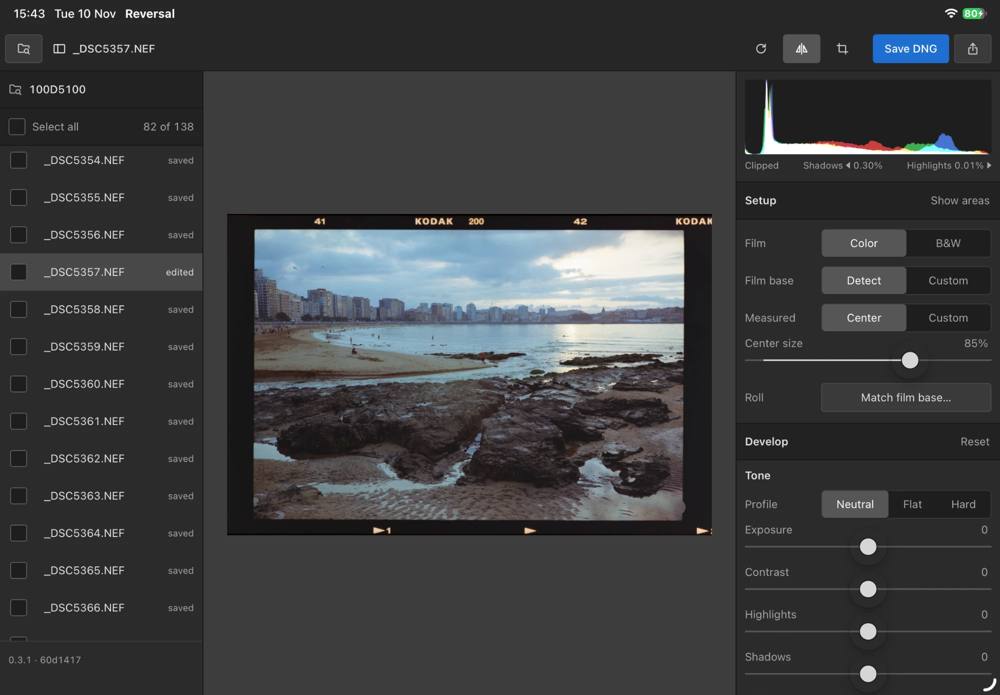
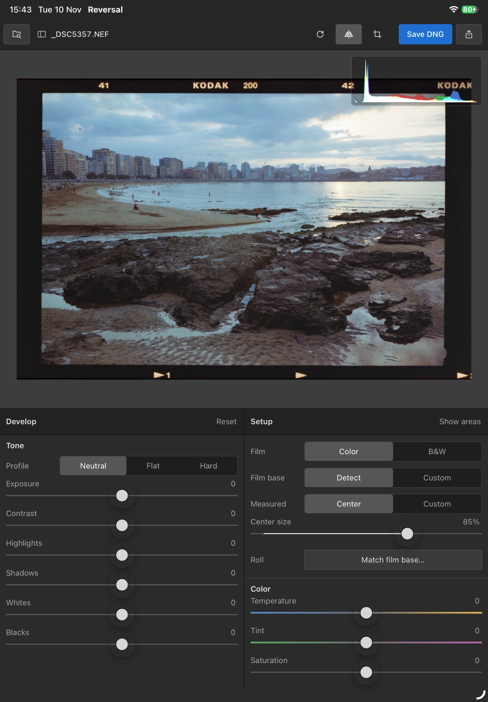
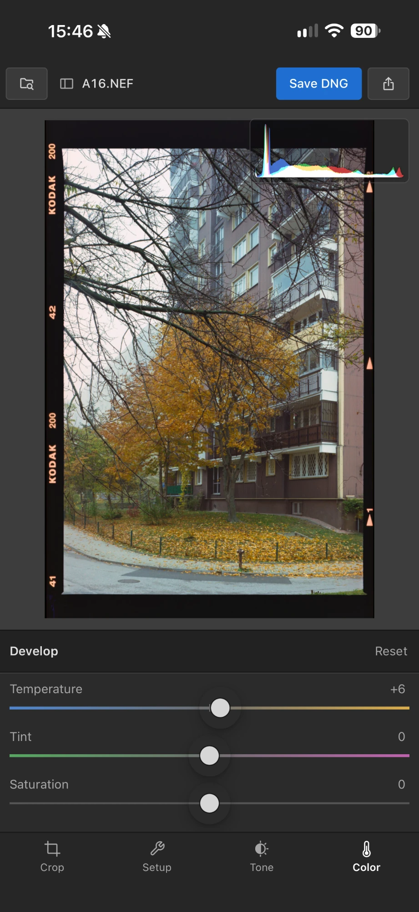

<p align="center">
  
</p>

<h1 align="center">Reversal</h1>

<p align="center">Film negative scans in, positive DNGs out. Pre-alpha.</p>

Reversal takes a RAW scan of a negative and writes a positive, losslessly compressed DNG. It bakes the inversion into the pixels but keeps them 16-bit, linear Rec.2020, so every RAW tool treats the file as an ordinary positive image. Conversion happens in density and writes a scene-linear positive, with the film base subtracted exactly.

Open it in a RAW editor of your choice, on desktop or mobile, with no plugin or color profile to install. Your edits stay on the DNG, with no need to export massive TIFFs or lossy JPEGs for basic edits.


## Status

Reversal is pre-alpha, so expect rough edges and changes. Submit feedback via [GitHub issues](https://github.com/janwiktor/reversal/issues).

- **Platforms:** a Mac app, or self-hosted from source as a command line and local web UI. An app for iPhone and iPad is a prototype: it builds from source and isn't released.
- **Film:** color and black and white negatives, detected per frame. Slide film is out of scope.
- **Cameras:** limited testing, on files from a single DSLR (Nikon D5100 NEF) and one light source. Other cameras that LibRaw reads should open, but the color correction was fitted to this setup.
- **Editors:** DNG rendering is benchmarked against Adobe Camera Raw only. Other tools may show the same file differently.

### What's next

First of all: testing, and testing, and more testing. More file types, cameras, pixel shift images, narrow band light sources etc.

Feature ideas live in [GitHub issues](https://github.com/janwiktor/reversal/issues).

## Principles
### 🎯 Solve one problem well
Make editing film scans in RAW editors feel like any other photo. Color-accurate film negative reversal. Camera RAW scan files to positive lossless DNG. This app is not going to be an all-in-one end-to-end studio for image processing.

### 🧩 Modular and portable
Color conversion core can drive a web, desktop, or mobile app, with device appropriate GUIs each. Plug it into your mobile or desktop workflow, and continue editing in your preferred RAW editing tool.

### 💨 Lightweight and fast
The right amount of software to do the job, with minimal but quality UI. Process a batch of scans quickly, then hand over.

## How it works

1. **Reads the RAW scan** through LibRaw, as linear camera data with no color rendering applied.
2. **Inverts in density.** It reads the film base from the unexposed edge of the film, then finds how gray runs through the dye layers in each frame, so neutrals stay neutral from shadows to highlights. Color and exposure are measured on the center of the scan, 85% of each side by default, to stay clear of the holder and rebate. You can change the size or draw the area yourself.
3. **Detects color and black and white stocks** by how color channels move together. Black and white becomes one silver density, written gray, with black and white profiles. Setup shows the result and lets you choose the other.
4. **Writes a scene-linear positive:** a 16-bit LinearRaw DNG in linear Rec.2020, with spare highlight range that a RAW editor can recover.

Your source files are never changed. Each DNG stores its conversion settings in its metadata, and the web UI also saves them in a settings file next to the DNG, so a frame reopens as you left it.

## Install

The Mac app is on the [Releases](https://github.com/janwiktor/reversal/releases) page, for Apple Silicon and macOS 13 or later. It isn't notarized, so the disk image includes the steps to open it the first time.

Everything else builds from source. On macOS with Homebrew:

```bash
brew install rustup libraw pkgconf
```

```bash
rustup default stable
```

```bash
cargo build --release
```

If `cargo` isn't found, add `/opt/homebrew/opt/rustup/bin` to your `PATH`.

### Building the Mac app

You also need Xcode:

```bash
packaging/macos/build.sh
```

This writes a disk image to `dist/`.

### Building the iOS app

The app for iPhone and iPad is a prototype, for iOS 17 or later. It needs Xcode on an Apple Silicon Mac, and Rust's iOS targets:

```bash
rustup target add aarch64-apple-ios aarch64-apple-ios-sim
```

```bash
open packaging/ios/Reversal.xcodeproj
```

Run it in a simulator from Xcode. The first build downloads and builds LibRaw, so it takes a few minutes. To run it on a device, name your development team in `packaging/ios/Local.xcconfig`, which stays out of git:

```
DEVELOPMENT_TEAM = ABCDE12345
```

## Use

In the Mac app, choose a folder of scans. Without the app, open the web UI on a folder; it runs locally at http://127.0.0.1:8787.

```bash
./target/release/reversal ui path/to/scans
```

Both save DNGs to a `positives` folder inside the folder you chose.

Each frame remembers its settings as you change them. Select several frames to save them together, each with its own settings; frames you haven't touched get the automatic conversion. If a save is cut short, Reversal offers the frames it didn't reach when the folder is next open.

The centered measuring area doesn't suit full film strips: for those, set a custom measured area and crop to it.

### Matching a roll

Frames of one roll can share a film base. Choose Match film base… under Setup, review the film base measured on each frame, and select which frames to use; or pass `--roll` on the command line. This helps most when some scans don't show the unexposed edge of the film, as long as most of them do. Each frame keeps its own color analysis and Develop settings.

### On iPhone and iPad

<p align="center">
  
  
  
</p>

The prototype shows the same controls, laid out for the screen: on a phone, the image with one panel of tools under it. Scans reach it four ways:

- **Open a folder** in Files or on a card, and work on it in place.
- **Copy in** files or a folder, as a roll kept in the app.
- **Choose raw photos** from the photo library. Only raw photos come along, because a JPEG or HEIC of a negative has lost what the conversion measures.
- **Open raw files** in Reversal from another app.

After a save, the share button hands the DNGs to Photos, Files or another app. From iOS 26, a save goes on while the app is off screen, more slowly. The start screen lists the rolls in the app with their size, to rename, export or delete.

### Command line

```bash
./target/release/reversal convert scan.NEF --flip --rotate 3 --crop-area
```

| Option | What it does |
| --- | --- |
| `--exposure`, `--contrast` | Tone, −100 to +100 |
| `--highlights`, `--shadows`, `--whites`, `--blacks` | Tone curve, −100 to +100. Saved in the profile, so the stored image keeps everything |
| `--film` | `auto` (default) detects each frame; `color` or `bw` converts every input as that |
| `--profile` | `neutral` (default), `flat` (low contrast, no clipping) or `hard` (more contrast). The DNG opens with this one and carries the others |
| `--temperature`, `--tint`, `--saturation` | Color, −100 to +100. Black and white ignores them |
| `--flip` | Mirror left-right, for scans made emulsion side up |
| `--rotate`, `--straighten` | Quarter turns (0–3), and straighten in degrees |
| `--area-percent` | Center size: the centered area where color and exposure are measured, default 85 |
| `--crop-area` | Crop to the measured area; the default keeps the entire scan |
| `--roll` | Measure one film base across the inputs and use it on each |
| `--compression` | `ljpeg` (default) or `none` |
| `-o` | Output file or folder; the default is `<name>-positive.dng` next to the input |

Camera EXIF isn't copied to the DNG yet.

## Development

```bash
cargo test
```

```bash
cargo fmt && cargo clippy --all-targets -- -D warnings
```

`crates/reversal-core` is the conversion engine, with no UI. `crates/reversal-cli` holds the command line and the web UI, and `crates/reversal-ios` wraps the engine as a library for the iOS app. The Mac and iOS apps are in `packaging/`. See [AGENTS.md](AGENTS.md) for project conventions, and the [wiki](https://github.com/janwiktor/reversal/wiki) for how it works in detail and the evidence behind it. The wiki is generated from [`docs/`](docs), so changes go there.

## License

Copyright © 2026 Jan Ambroziewicz. Reversal is under the [Mozilla Public License 2.0](LICENSE), with no warranty. If you share a changed version, your changes to existing files stay open under the same license; new files of your own may be under other terms. The photos in the screenshots aren't covered by this license. Releases 0.1.0 to 0.1.2 remain available under the GPL they were published with.

This product includes DNG technology under license by Adobe.

RAW decoding uses [LibRaw](https://www.libraw.org/), under the CDDL 1.0, with its source available. It's a system library when you build the command line from source, and built into the Mac and iOS apps. Each release includes the source of LibRaw and of the Rust crates in the app. LibRaw is copyright © 2008-2025 LibRaw LLC.
