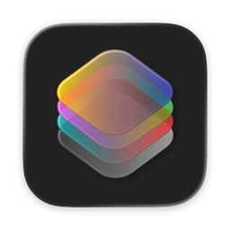
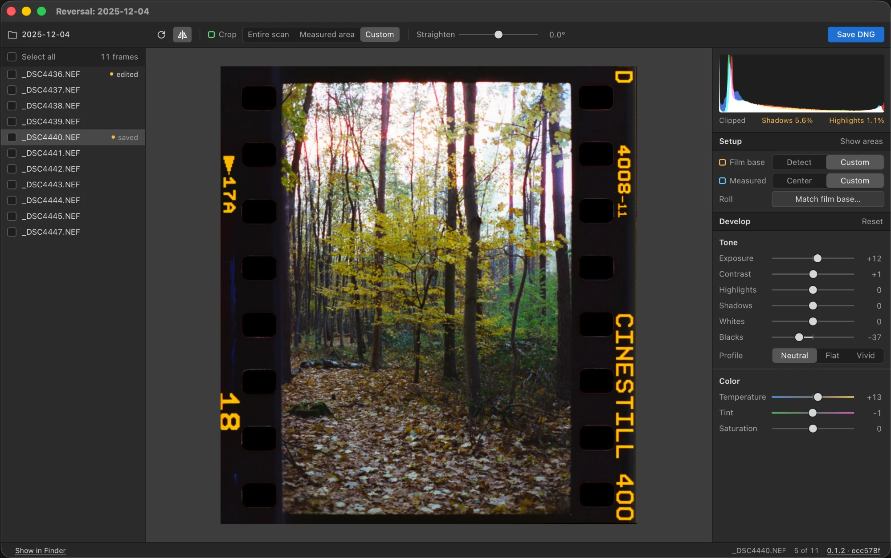

<p align="center">
  
</p>

<h1 align="center">Reversal</h1>

<p align="center">Film negative scans in, positive DNGs out. Pre-alpha.</p>

Reversal takes a RAW scan of a negative and writes a positive, losslessly compressed DNG. Open it in a RAW editor of your choice, on desktop or mobile: sliders work the right way round, with no plugin or color profile to install. Your edits stay on the DNG, with no need to export massive TIFFs or lossy JPEGs.



## Status

Reversal is pre-alpha, so expect rough edges and changes.

- **Platforms:** a Mac app, or self-hosted from source as a command line and local web UI.
- **Film:** color negative only. Black and white not handled yet.
- **Cameras:** limited testing, on files from a single DSLR (Nikon D5100 NEF) and one light source. Other cameras that LibRaw reads should open, but the color correction was fitted to this setup.
- **Editors:** DNG rendering is benchmarked against Adobe Camera Raw only. Other tools may show the same file differently.

### What's next

- Testing on more files from more cameras and light sources, and on pixel shift files
- [Black and white negative conversion](https://github.com/janwiktor/reversal/issues/14)
- [Rendering correctness in other tools](https://github.com/janwiktor/reversal/issues/13)

More in [GitHub issues](https://github.com/janwiktor/reversal/issues).

## How it works

1. **Reads the RAW scan** through LibRaw, as linear camera data with no color rendering applied.
2. **Inverts in density.** It reads the film base from the unexposed edge of the film, then finds how gray runs through the dye layers in each frame, so neutrals stay neutral from shadows to highlights. Color and exposure are measured on the center of the scan, 85% of each side by default, to stay clear of the holder and rebate. You can change the size or draw the area yourself.
3. **Writes a scene-linear positive:** a 16-bit LinearRaw DNG in linear Rec.2020, with spare highlight range that a RAW editor can recover.

Your source files are never changed. Each DNG stores its conversion settings in its metadata, and the web UI also saves them in a settings file next to the DNG, so a frame reopens as you left it.

## Install

There are no prebuilt downloads yet, so build from source. On macOS with Homebrew:

```bash
brew install rustup libraw pkgconf
```

```bash
rustup default stable
```

```bash
cargo build --release
```

If `cargo` isn't found, add `/opt/homebrew/opt/rustup/bin` to your `PATH`.

### Mac app

The Mac app needs Apple Silicon and macOS 13 or later. To build it you also need Xcode:

```bash
packaging/macos/build.sh
```

This writes a disk image to `dist/`. The app isn't notarized yet, so the disk image includes the steps to open it the first time.

## Use

In the Mac app, choose a folder of scans. Without the app, open the web UI on a folder; it runs locally at http://127.0.0.1:8787.

```bash
./target/release/reversal ui path/to/scans
```

Both save DNGs to a `positives` folder inside the folder you chose.

Each frame remembers its settings as you change them. Tick several frames to save them together, each with its own settings; frames you haven't touched get the automatic conversion.

The centered measuring area doesn't suit full film strips: for those, draw the area and crop to it.

### Matching a roll

Frames of one roll can share a film base. Choose Match film base under Setup, review what each frame reads, and decide which frames count; or pass `--roll` on the command line. This helps most when some scans don't show the unexposed edge of the film, as long as most of them do. Color curves and exposure stay each frame's own.

### Command line

```bash
./target/release/reversal convert scan.NEF --flip --rotate 3 --crop-area
```

| Option | What it does |
| --- | --- |
| `--exposure`, `--contrast` | Tone, −100 to +100 |
| `--highlights`, `--shadows`, `--whites`, `--blacks` | Tone curve, −100 to +100. Saved in the profile, so the stored image keeps everything |
| `--profile` | `neutral` (default), `flat` (low contrast, no clipping) or `vivid`. The DNG opens with this one and carries the others |
| `--temperature`, `--tint`, `--saturation` | Color, −100 to +100 |
| `--flip` | Mirror left-right, for scans made emulsion side up |
| `--rotate`, `--straighten` | Quarter turns (0–3), and fine rotation in degrees |
| `--area-percent` | Size of the centered area that color and exposure are measured on, default 85 |
| `--crop-area` | Crop to that area; the default keeps the whole scan |
| `--roll` | Measure one film base across the inputs and use it on each |
| `--compression` | `ljpeg` (default) or `none` |
| `-o` | Output file or folder; the default is `<name>-positive.dng` next to the input |

Camera EXIF isn't copied to the DNG yet.

## Development

```bash
cargo test
```

```bash
cargo fmt && cargo clippy --all-targets -- -D warnings
```

`crates/reversal-core` is the conversion engine, with no UI. `crates/reversal-cli` holds the command line and the web UI. See [AGENTS.md](AGENTS.md) for project conventions.

## Notices

This product includes DNG technology under license by Adobe.

RAW decoding uses [LibRaw](https://www.libraw.org/), linked as a system library.
