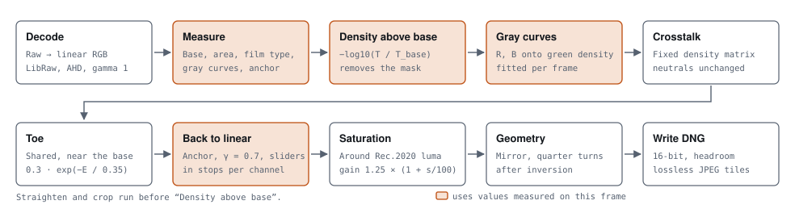
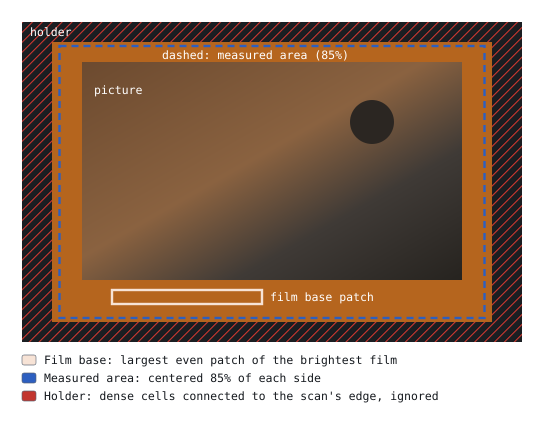
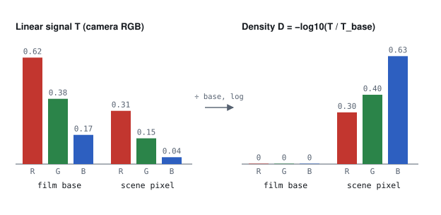
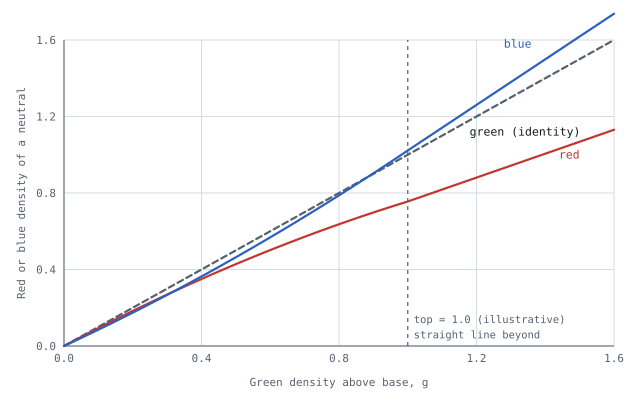
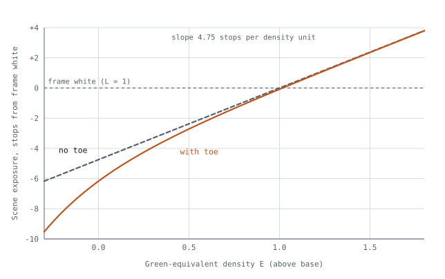
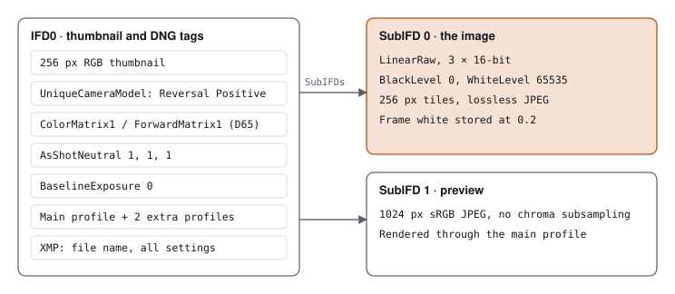
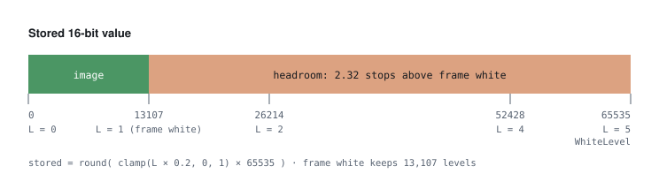
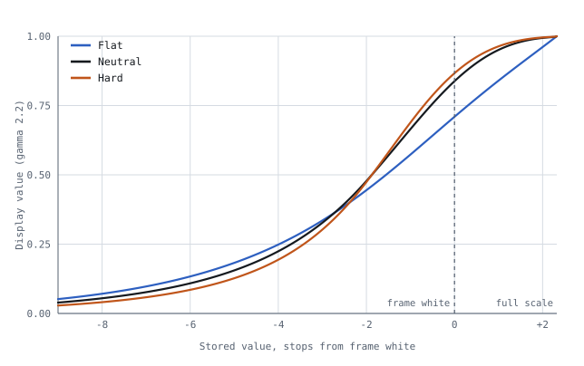
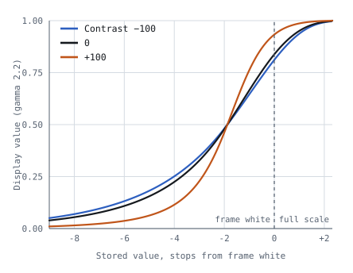
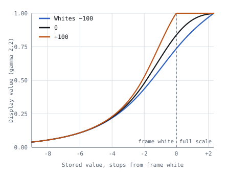

# Reversal: Conversion Method

*Technical whitepaper · engine 0.3.2, conversion model 3 · November 2026*

*Author note: this is a working draft that documents current conversion model Reversal uses, and the testing done to validate its performance. As of November 2026, the sample size of scans, film stocks, cameras and light sources used, is very limited. My intention is to expand the scope of tests and publish the dataset alongside the paper as I gain confidence in the method. - Jan*

Reversal turns a camera scan of a color or black and white negative into a scene-linear positive
raw file that edits like an ordinary digital photo. This paper describes each processing step, from
decoding the scan to the bytes written in the DNG, gives the formulas and constants the engine uses,
and separates what rests on published film science from what was based on test runs. Where a step
was chosen over alternatives, the test results are summarized alongside it.

See Appendix A for formulas needed to reproduce the conversion.

## 1. Approach

A negative scan is not a regular scene. It is three dye layers measured through a backlight, so the camera
acts as a densitometer. Film records exposure as optical density, which rises in proportion to log
exposure over most of its range (Hurter & Driffield, 1890; James, 1977). Densities of superimposed
absorbers add, so the orange base of a color negative is an offset in density that can be subtracted
per channel (Giorgianni & Madden, 2008; Hunt, 2004). This is exact at a single wavelength; through a
camera's broad channels, whose passbands the mask's color varies across, it is a close approximation.
Any per-channel gain, such as a white balance, cancels exactly. In linear RGB the same correction is
a per-channel division, and tone curves applied to the inverted signal shift the color balance with
every change. Reversal therefore does its color work in density and writes the result as linear light.

- **Density.** The film base is subtracted per channel, and any white balance applied to the scan cancels with it.
- **Per-frame gray curves.** Red and blue density are mapped onto green density with curves fitted to the frame's own near-neutral pixels, so grays stay gray at every density.
- **Linear and high-bit.** 32-bit float inside, 16-bit linear Rec.2020 on export, with 2.3 stops of highlight headroom kept in the file.
- **Look in the profile.** Exposure and color are written into the pixels. Tone shaping goes into the DNG's profile curves, so it stays adjustable in a raw editor.
- **Deterministic and non-destructive.** The same input and settings give identical bytes. Source files are unmodified.



**Figure 1. The pipeline.** The first row reads the scan; the second shapes the result. Shaded boxes
use values measured on each frame; plain boxes use fixed constants or slider values. Straighten and
crop run before inversion, mirror and quarter turns after it. The sections below refer to these
steps by number, counting from Decode as step 1.

## 2. How choices were tested

Most choices were made by converting a test set and comparing the result with a finished scan of the
same frame, made with other software and adjusted by hand. That reference shows one person's
rendering, not the true colors of the scene, so a score guides a decision rather than proving it.

The main test set is 22 color frames from 6 rolls, presenting a variety of conditions, all scanned with a Nikon D5100: 14 frames the
model was first fitted on, and two harder rolls of 4 frames each (forest and metro scenes). Other
tests use other sets, which are named where they appear. Each conversion is rendered to 8-bit sRGB
with a fixed preview curve, aligned to its reference, and both are converted to CIELAB (D65). Only
pixels shown between L\* 12 and 92, on film denser than 0.03 above the base, count in.

| Score | How it is computed | Scale and extremes |
| --- | --- | --- |
| **Color error** | Distance between conversion and reference in the a\*b\* plane, averaged over a frame's pixels, then over frames. Lightness is left out. | 0 means every pixel has the reference's color. No upper limit: two saturated opposite colors differ by over 100. For scale, a full CIELAB difference (ΔE\*ab, lightness included) of about 2.3 is just noticeable side by side (Mahy et al., 1994). The shipped method scores 7.55. |
| **Brightness error** | Root mean square of the L\* difference. | L\* runs from 0 (black) to 100 (white). 0 means identical lightness everywhere; 100 would be black against white. Shipped: 8.67. |
| **Neutral cast** | Over pixels the reference shows as near-neutral (chroma below 7, L\* above 18): the length of the average a\*b\* difference. Frames with 100 or fewer such pixels are left out. | 0 means grays carry no tint on average, relative to the reference. Random errors that cancel out don't count, only a shared tint does. Shipped: 3.82. |
| **Hue drift** | Angle between the hue of the conversion and of the reference, in the a\*b\* plane, over pixels of one hue family (blues, greens or warm tones). | 0° is the same hue, 180° the opposite hue. |
| **Chroma ratio** | Mean chroma of the conversion divided by that of the reference. | 1 means equally saturated on average; above 1 is more saturated. |
| **Frames better / worse** | How many of the 22 frames an alternative improves or worsens, by color error. | Counts out of 22. |

Some results are in density, the base-10 log of how much light the film blocks. A density
difference of 0.3 halves the light, one stop. In the positive, a density error in the exposure
anchor (step 7) of 0.1 moves the picture by about half a stop.

Comparisons of one test are made under the same conditions. Absolute values differ between tests
that ran with different film base detection or measured area: on the full main test set the shipped
method scores color error 7.55 in one test and 8.10 in another. Each result below is given with its own baseline; compare numbers within one
comparison, not across comparisons.

## 3. Input and measurement

### Step 1: Decode

LibRaw (LibRaw LLC, n.d.) reads camera raw and DNG files (NEF, CR2, CR3, ARW, RAF, RW2, ORF, PEF and
others) into linear camera RGB at 16 bits, with AHD demosaicing and gamma 1. Nothing that renders
color is applied: no camera matrix, no automatic brightness, and all channel multipliers are 1. The
camera's color profile describes scenes, not dye layers, so it is not used. The decoder's scaling
is fixed, so every frame of a roll is decoded to the same levels and frames stay comparable.

The camera's own channel sensitivities therefore define density here. Film work otherwise measures
density through standardized spectral responses, such as Status M (International Organization for
Standardization, 2009) or printing density (Society of Motion Picture and Television Engineers,
1999); Plutino (2024) reviews the color encodings used in film digitization. Matching one of those
responses would need a transform for each camera, which Reversal does not attempt.

### Step 2: Measure

Measurement runs on the scan downsampled by 4 in each direction. Pixels at or above 0.9 of full scale
in any channel are light through holes or gaps, and are left out. These values are measured before
any pixel is converted.



**Figure 2. What the analysis looks at.** The film base comes from the film edge or a strip between
frames. The scene is measured in a centered share of the scan. Dense areas connected to the scan's
edge are treated as film frame or holders used in scanning, and left out. An area the user draws is
measured exactly as drawn.

| Value | How it is measured |
| --- | --- |
| Film base | The scan is split into small cells. Cells whose levels vary by less than 5% and lie within 7% of the brightest even cells count as clear film, and the base is the median of the largest rectangle of them. Rectangles at the film's edges are tried first, then a strip across the scan. Base detection skips cells near clipped light. When nothing looks like clear film, the app says so and asks users to draw the area manually or match from other frames in the roll. Roll analysis uses the median of the bases of selected frames, which the app also uses to flag a frame whose own base is over 6% off in any channel. |
| Measured area | The centered 85% of each side, adjustable, or an area the user draws. Holder pixels are left out (below). |
| Film type | Color or black and white, from how the three densities rise together (section 5). |
| Gray curves and exposure anchor | Fitted to the measured area (steps 4 and 7). |

**Film base.** Taking the largest even patch, rather than the median of the brightest 3% of pixels,
keeps holes, edge markings and picture detail out of the reading. On 25 frames the brightest-pixel
method drew its sample through holes and markings, and landed on picture content when no film edge
showed. On the main test set it costs nothing in score: color error 7.55 against 7.63, brightness
error 8.67 against 8.69, measured with slightly different scripts. The patch method reported no
clear film on 5 of the 25 frames: 4 of them barely showed a film edge and 1 was a real miss.

**Measured area.** The whole scan was rejected because the holder's black edge set the white point.
Centered areas from 95% down to 70% of each side took color error from 7.83 to 7.47. At 95% the area
takes in holders and brightness error is 11.09; at 80% it is 8.48 and at 85% 8.69. 85% is the
default because it has the lowest neutral cast, 3.77, and keeps clear of holders on framed scans. One identified edge case: uncropped square film frames scanned with most common 2:3 camera sensors require manual area selection due to frame proportions.

**Holder.** On scans of square frames inside a 3:2 sensor, an area wide enough to hold the frame also
holds part of the holder, which reads near black and takes the white point. The engine marks cells
of 4×4 analysis pixels whose median green density is more than 1.2 above the base, keeps those
connected to the scan's edge, and grows them by one cell plus 1.3% of the scan's long side. Picture
can be that dense too, which is why only cells connected to the edge count; if they reach the
central 50% of each side, they are taken for picture and nothing is masked. On 12 frames from a Fujifilm camera,
the mask brought the exposure anchor to within a mean of 0.05 density (worst 0.13) of the anchor
measured on a tight 55% area, from a mean of 0.45 (worst 1.02): from about two stops off to a
quarter stop. A limit of 1.0 took real picture on 2 frames; 1.6 left the anchor 0.22 off on 1. Without a margin,
the holder's soft edge misled the gray fit on 2 frames. On the main test set the mask changes no
score.

## 4. The density model for color negatives

### Step 3: Density above the film base

For each channel, density is the negative log of the signal relative to the film base:

```math
D_c = -\log_{10}\left(T_c \,/\, T_{\text{base},c}\right)
```

At clear film every channel reads 0, which removes the orange mask in one operation. The reference
is the film's minimum density, base plus fog, from which sensitometry counts density (James, 1977).
Because the base is divided out per channel, any white balance applied before this step cancels too.



**Figure 3. Why the orange mask disappears.** Left: linear camera signals for the film base and for
one scene pixel, with the base strongly orange. Right: after dividing by the base and taking the log,
the base reads 0 in every channel and the pixel's three densities are directly comparable. Values
are illustrative.

### Step 4: Gray curves

The three dye layers have different contrast, and the difference changes with density. A black and
white point per channel cannot keep neutrals neutral across the range. Instead, red and blue density
are each described as a function of green density, with a curve through the film base. Inverting
that curve turns a red or blue density into its *equivalent density*: the green density of a neutral
with that red or blue density. A neutral then has the same equivalent density in all three channels
by construction.

That the layers differ is documented: manufacturers publish a characteristic curve for each layer of
a stock (e.g., Eastman Kodak Company, 2026), and colored couplers add a density-dependent mask on top
(Hanson, 1950; Hunt, 2004). Estimating gray balance as a function of density from the scene itself,
without a reference, is described in photofinishing patents assigned to Fuji Photo Film. Yamana
(1995) balances each frame on its own measured densities. Terashita (2000a, 2000b) sorts pixels by
green density, keeps those near the running average of red and blue at each green density, and
accumulates them over many frames of the same film type. Reversal follows that structure: red and
blue are measured against green, near-neutral pixels are selected in bands of green density, and each
frame's fit is pulled lightly toward an average across rolls. The curve's form and the fitting
procedure are Reversal's own.

```math
D_c(g) = \text{bend}_c \cdot g^2 + \text{slope}_c \cdot g \qquad 0 \le g \le \text{top}
```

Above `top`, the curve continues as a straight line close to its tangent (Appendix A). The fit
starts from an average across rolls, toward which every frame's fit is also pulled:

| Channel | bend | slope |
| --- | --- | --- |
| Red | −0.2008 | 0.9564 |
| Blue | +0.1883 | 0.8340 |

The fit uses pixels with green density above 0.15, sorted into 18 bins between 0.15 and 1.7, from
0.05 to 0.25 wide. It runs
five times, keeping pixels whose red and blue lie within a band around the current curves that
narrows from ±0.15 to ±0.04 density. Each pass fits the median of each bin holding at least 40 such
pixels, with every bin counting equally and a weak penalty on moving away from the average curves.
`top` is the 97th percentile of green density among the final near-neutral pixels.



**Figure 4. Gray curves.** For a neutral, red density grows more slowly than green. Blue starts just
below green and grows faster, crossing it near 0.9. The dashed line is green against itself.
Plotted are the starting curves with an illustrative `top` of 1.0; each frame's own fit moves them.

**Tested against the alternatives** (main test set, color error unless stated):

- **Black and white point per channel:** 10.3 against 7.7 for gray curves on the 14 original frames, and 11.2–18.1 and 13.9–16.0 against 8.0 on the two harder rolls. Brightness error fell from 19.8 to 8.8 on the original frames. The ranges run from a hand-set area to the shipped area.
- **Mean of the three densities, or a mean weighted by the light each channel gets through the base, as the axis instead of green:** 7.62–7.71 against 7.55, neutral cast 3.92–4.00 against 3.82, with 8–10 frames worse and 3–7 better. Green was also the least noisy axis in almost every density bin, so a steadier fit had little to gain.
- **Curve anchored on the highlights instead of through the base:** 16–18 against about 8, because blue skies are not neutral. A free offset from the base was worse on every group of frames.
- **Two bends, or a free-form curve:** 8.81 and 8.90 against 8.26 for one bend.
- **A fixed search band, with bins weighted by their pixel count, instead of a narrowing band with equal bins:** 14.9 against 9.4 on the forest roll.
- **Pull toward the average:** the light pull scores 8.10, against 8.26 with no pull and 9.18 with a fixed 50% blend. With the current base detection, double the pull scores 7.64 against 7.55, and a pull set per frame from how much gray evidence it holds 7.73 on rolls held out of choosing it.
- **One curve per roll instead of per frame:** 8.8–12.5 against about 8.
- **Leaving foliage or sky hues out of the search:** 7.57–7.97 against 7.55, and foliage turned teal on two forest frames. With a guard that keeps foliage when it is over 15% of a pass's candidate pixels, 7.38 with 11 frames better and 3 worse, but nearby settings gave 7.33–7.55 and one frame carried almost 40% of the gain; not adopted.

The search band and the exposure anchor's mix (step 7) were chosen after seeing the two harder
rolls, so their scores there are optimistic.

### Step 5: Crosstalk

The camera's channel sensitivities overlap the dyes, so each dye layer also registers in the
neighboring channels. A telecine design shifts the scanner's red sensitivity toward the cyan dye's
absorption peak to reduce this crosstalk (Moore et al., 1991). A camera's sensitivities are fixed, so
Reversal corrects afterward, with a fixed linear correction on the red–green and blue–green
differences of equivalent density:

```math
x = E_r - E_g, \qquad y = E_b - E_g
```

| New value | from x | from y |
| --- | --- | --- |
| E<sub>r</sub> − E<sub>g</sub> | 1.1532 | 0.3195 |
| E<sub>b</sub> − E<sub>g</sub> | 0.0973 | 1.3271 |
| Shift of E<sub>g</sub> | −0.0460 | −0.1033 |

Neutrals have zero differences and pass through unchanged. The correction has the form of classical
masking in color reproduction, which corrects the dyes' unwanted absorptions with a linear combination
of densities (Evans et al., 1953; Hanson & Brewer, 1954, 1955; Hunt, 2004; Yule, 1967); here it
corrects the overlap between sensor and dyes as well. The values were fitted to a Nikon D5100 and one
light source, not derived.

**Tested:** the correction cut hue drift on blues from 18–21° to 7–12°, and on warm tones from 5–10°
to 2–7°, but greens drift 7–10° further. A forward model of the scan, built from measured camera
sensitivities (Jiang et al., 2013), dye curves read from published data (Eastman Kodak Company, 2026)
and estimated spectra of the light, predicted a correction in the same direction (cosine similarity
0.86, where 1 is the same direction and 0 unrelated) but about 2.9 times as strong. With saturation
set so every variant had the same overall chroma, it scored color error 7.88 with the best estimate
of the light, against 7.55 for the fitted correction and 7.76 for none. Only for a narrowband RGB
light, which these scans didn't use, did it score better (7.45), so the model's dependence on the light
is not supported by these scans. Its prediction also varies widely between cameras: the term that
corrects blue for green is −0.88 for the D5100 and ranges from −0.41 to −2.40 across the 28 cameras of
the sensitivity database, so a correction fitted to one camera may not suit others.

### Steps 6 and 7: Toe, exposure and film gamma

A small toe, shared by all channels, expands densities near the base. Exposure and film gamma then
turn density back into scene-linear light:

```math
E' = E - 0.3\, e^{-\max(E,\,-0.3)/0.35}
```

```math
L_c = 10^{\,(E'_c - A)/\gamma \;+\; o_c \log_{10} 2}, \qquad \gamma = 0.7
```

`A` is the exposure anchor and `o` the slider offsets in stops. *Frame white* is L = 1, where
E′ = A with the sliders at 0. Below E = −0.3 the toe is constant. One density unit corresponds to
1 / (0.7 × log<sub>10</sub>2) ≈ 4.75 stops of scene exposure. At the base the toe lowers values by
0.3 density, about 1.4 stops, and spreads neighboring shadow values 1.86 times further apart; its
effect fades to a factor of 1.12 at a density of 0.7.

The anchor is the mean of the 99th percentile and the average of the green equivalent density after
crosstalk and before the toe, plus 0.1027. The average leaves out bare film (less than 0.03 above
base). In a test on the three groups of the main test set (the 14 original frames and each harder
roll), this mix gave brightness error 9.6–15.9 across the groups, against 11.3–17.8 for the highlights
alone and 9.0–23.1 for the average alone; in that test, the best anchor chosen per frame with
hindsight reached about 8.
The mix was kept for its better worst case. A center-weighted average was within about 1 of the plain
average and was dropped.

Both parts have a long record. The toe is the low-exposure region of the characteristic curve, where
contrast falls below its mid-scale value (Hurter & Driffield, 1890; James, 1977); a film patent
specifies toe contrast as a ratio to mid-scale contrast (Brewer et al., 1998). Dividing density by the film's
gamma and taking the antilog is the same form as the Cineon log-to-linear conversion, which uses a
conventional negative gamma of 0.6 (Kennel, 1995; Kennel & Snider, 1993); density-based encodings of
negative scans are still standardized for motion picture work (Society of Motion Picture and
Television Engineers, 2020). Patents on digital photofinishing likewise split the conversion into
separate digital steps, such as printing density, an underexposure gamma correction and scene
balance (Buhr et al., 2001), or inversion, black and white points and a midtone contrast curve
(Lin et al., 2001; Lin & Tretter, 1998). Reversal's γ of 0.7, the exponential toe and its constants
were chosen on the 14 original test frames, and lowered brightness error on all three groups.



**Figure 5. From density to scene stops.** Output in stops from frame white against green equivalent
density, with the anchor set to an illustrative 1.0. The dashed line is the model without a toe.
Exposure, Temperature and Tint move the line up or down per channel, in stops, without changing its
slope.

### Step 8: Saturation gain and slider adjustments

Saturation is linear, around Rec.2020 luminance with weights 0.2627, 0.6780 and 0.0593
(International Telecommunication Union, 2015). A built-in gain of 1.25 brings the chroma ratio of the
main test set to the reference's. The Saturation slider scales that gain, from 0 at −100, which gives
black and white, to 2.5 at +100. Negative results clip to zero. Applying the same correction in
linear light after inversion, rather than in density, scored color error 7.77 against 8.66 on a
separate set of 8 hand-finished scans of one film stock.

Exposure (±3 stops in every channel), Temperature (±0.6 stops in red and the opposite in blue), Tint
(±0.6 stops in green and half the opposite in red and blue) and Saturation change the pixels. Contrast, Highlights, Shadows, Whites, Blacks and the choice of look change only the profile curves
(section 6).

## 5. Black and white negatives

Silver blocks every color about equally (James, 1977), so black and white needs no gray curves,
crosstalk or saturation. Density above base is still taken per channel, which removes the base's
tint, fog and the scan's white balance. The three densities are then combined into one, each weighted
by the light its channel gets through the base:

```math
E = \sum_c w_c D_c, \qquad w_c = \frac{T_{\text{base},c}}{\sum_k T_{\text{base},k}}
```

Shot noise in density falls as the signal grows, so this weights each channel roughly by the
inverse of its noise variance, treating the channels' noise as independent. Toe, anchor and γ are the
same as for color. The positive has that one value in all three channels, and only Exposure changes
the pixels. No black and white reference scans were available, so the
conversion was checked by eye on 6 frames from 6 rolls and two cameras.

### Telling the two apart

Detection uses cells of 4×4 analysis pixels as density above base. The cells are binned by green
density in steps of 0.05, and a curve is drawn through the median cell of each bin holding at least
40 cells. A frame is black and white when 90% of cells lie within 0.02 density of that curve and red
density rises with green at a slope within 0.05 of 1. Color film fails the first test wherever the
scene has color, and fails the second even on a gray scene, because its dye layers rise at different
rates. A frame with fewer than 6 filled bins can't be told and stays color, the conversion that loses
nothing.

On 220 scans (160 black and white, 60 color, from a Nikon D5100 and a Fujifilm camera), black and
white frames reached a spread of 0.004–0.011 and a red slope of 1.000–1.024; color frames 0.0197–0.18
and 0.67–0.93, including near-gray scenes. Both tests together classified every frame correctly.
Spread alone would have called a near-gray color frame black and white. The film base's own color
(red against blue) was also tried and rejected: it depends on the light and white balance, and misread
a frame whose base reading landed on bare light. The limits were
chosen on these same scans, with none held out.

## 6. Writing the DNG

The result is a 16-bit, scene-linear LinearRaw DNG in linear Rec.2020, written by a minimal in-house
writer to the DNG specification (Adobe Inc., 2023). The data is already demosaiced, so raw editors
skip their own demosaicing and treat the file as a positive photo from a camera named "Reversal
Positive". The format choices below were checked by opening test files in Adobe Lightroom Classic,
Lightroom mobile, Camera Raw, Apple Photos and Apple's raw engine.



**Figure 6. File layout.** IFD0 carries the thumbnail and the DNG-level tags; the 16-bit LinearRaw
image and the sRGB preview sit in sub-IFDs. All three profiles travel in the file, and the chosen
look is the main profile, because Apple Photos applies only that one. All settings are written to
XMP, so a conversion can be repeated.

### Highlight headroom

Frame white is stored at 0.2 of full scale, 2.32 stops below the top, so highlights above frame white
survive as recoverable data. Every sample is quantized as `round(clamp(L × 0.2, 0, 1) × 65535)`, the
only place precision is reduced. BlackLevel is 0, WhiteLevel 65535, BaselineExposure 0, and
AsShotNeutral 1, 1, 1 with `crs:WhiteBalance="As Shot"`, so the white balance slider starts neutral.
In Lightroom Classic, Lightroom mobile and Apple Photos, Highlights and Exposure recover the
headroom, except Exposure in Photos (section 8). Float16 samples worked in Adobe apps but failed in
Apple Photos and Finder.



**Figure 7. The 16-bit range.** Linear positive values (frame white = 1) map to stored values by a
factor of 0.2. Everything above 1.0 is headroom, up to 5.0, which a raw editor can bring back with
Highlights, Whites or Exposure. Clipping on the display is recoverable; clipping at 5.0 in the stored
data is not.

### Profile tone curves

Each profile carries a `ProfileToneCurve` of 1024 evenly spaced samples, pinned to (0, 0) and (1, 1).
Apple's raw engine misreads unevenly spaced samples at any count (on the curve's 0–1 output scale, a
Flat midtone read 0.27 instead of 0.38) and replaces curves with more than 1024 samples, or that miss either end, with a default. The
curve maps the whole stored range to the display and carries the highlight roll-off itself, which is
why BaselineExposure can be 0 for every look: renderers treat data above display white differently,
and with the roll-off in the curve and BaselineExposure 0, exports of one frame from Apple Photos
and Camera Raw differ by 1.37 in CIELAB ΔE (0 is identical), where they differed by 6.10 with an
exposure offset and the roll-off left to the renderers. The curve is built as a shoulder, a black point, an S-curve
(tanh) in a gamma-2.2 domain, then shadows and highlights bumps. At Whites −100 the shoulder is the
extended tone operator of Reinhard et al. (2002), with its white point at the top of the stored range.
`DefaultBlackRender` is None on every profile: left on auto, Apple's raw engine subtracted a black
level that sent 8–32% of pixels to black on four test frames, against about 0.3% expected. The in-app
preview applies the same curve to linear values on the ROMM RGB (ProPhoto) primaries (International
Organization for Standardization, 2013; Spaulding et al., 2000).



**Figure 8. The three looks.** Display value (gamma-2.2 encoded) against stored linear value in stops
from frame white; the 2.3 stops right of frame white are the headroom. Every look rolls off from
two stops below frame white, so the headroom reaches display white without clipping. Neutral: S-curve
slope 1.5, frame white at 0.84. Flat: slope 0.4, the Whites −100 shoulder, frame white at 0.71. Hard:
slope 2.2, frame white at 0.87, plus saturation of 1.15 in a look table. A black and white frame gets
black and white versions of the same curves, with a look table that holds saturation at 0.

| Contrast | Whites |
| --- | --- |
|  |  |

**Figure 9. Two of the tone sliders on Neutral.** Left: Contrast multiplies or divides the curve's
slope by up to 2.6 at the ends of the slider. Right: Whites at −100 rolls the whole stored range off
below white; at +100 it clips sooner.

### Key DNG tags

| Element | Value | Reason |
| --- | --- | --- |
| Photometric | LinearRaw (34892), 3 samples, 16-bit integer | Widest reader support; no demosaicing needed |
| Color | Linear Rec.2020 through ColorMatrix1 and ForwardMatrix1 (D65) | Takes the camera out of the rendering |
| Version | DNGVersion 1.4, DNGBackwardVersion 1.3 | Any reader of DNG 1.3 or later can open the file |
| Compression | Lossless JPEG (International Telecommunication Union, 1992) in 256 px tiles; uncompressed optional, and for images narrower than one tile | Read everywhere; about 62–64 MB for a 16-megapixel scan |
| Geometry | Applied to the pixels; orientation stays normal | Nothing depends on a reader honoring crops or rotation |
| Previews | 256 px thumbnail, 1024 px sRGB JPEG | Fast browsing |
| Software tag | Version number only, no build hash | Builds of one version convert to identical bytes |

## 7. Basis of each step

The structure of the conversion follows established film science. Most specific shapes and constants
are Reversal's own and rest on the tests summarized above.

| Step | Established in the literature | Reversal's own choice |
| --- | --- | --- |
| 3. Density above base | Density as the log of transmittance relative to minimum density; densities of superimposed dyes add (Giorgianni & Madden, 2008; Hunt, 2004; James, 1977) | Camera channels as the density response, instead of Status M or printing density |
| 4. Gray curves | Layers have different characteristic curves (Eastman Kodak Company, 2026); gray balance as a function of green density, estimated from near-neutral scene pixels (Terashita, 2000a, 2000b); per-frame balance from the frame's own densities (Yamana, 1995) | Quadratic with one bend through the base, fitted per frame; narrowing band; light pull toward an average |
| 5. Crosstalk | Linear masking of unwanted dye absorptions in density, the same form (Hanson & Brewer, 1954, 1955; Hunt, 2004; Yule, 1967); scanner sensitivity shifted toward a dye's peak (Moore et al., 1991) | Matrix values, fitted to one camera and one light, acting on red–green and blue–green differences |
| 6. Toe | Toe region of the characteristic curve; toe contrast as a ratio to mid-scale (Brewer et al., 1998; Hurter & Driffield, 1890; James, 1977) | Exponential form and its constants 0.3, 0.35 and −0.3 |
| 7. Back to linear | Antilog of density over negative gamma, as in Cineon (Kennel, 1995; Kennel & Snider, 1993) | γ = 0.7 instead of the conventional 0.6; anchor from the 99th percentile and the mean |
| 8. Saturation | Rec.2020 luminance weights (International Telecommunication Union, 2015) | Gain of 1.25, matched to the reference scans |
| 10. DNG and profiles | DNG tags and profiles (Adobe Inc., 2023); lossless JPEG (International Telecommunication Union, 1992); extended tone operator (Reinhard et al., 2002) | Frame white at 0.2 of full scale; curve shapes, slopes and roll-off; tag choices settled by tests in editors |

No source found gives the specific curve shapes or constants of steps 4 to 7 for camera scans.

## 8. Known limits

- **One camera, one light for crosstalk.** The matrix was fitted to a Nikon D5100 and one light source, so other setups may drift in hue, greens most of all.
- **Scores rest on one reference look.** The reference scans are based on subjective evaluation and converted using standard image processing software, and the 14 original frames were used both to fit the model and to score it.
- **Holder detection** needs an opaque holder that reaches the scan's edge. A picture with dense areas touching the edge, as on a scan filled edge to edge, can lose them from the measuring; a drawn area replaces the mask.
- **Multi-frame film strips** need a drawn measured area and a crop.
- **Film base detection** reports no clear film on scans that show little of the film's edge.
- **Camera EXIF** is not copied to the DNG.
- **Apple Photos** clips bright highlights sooner than Camera Raw when Exposure is raised. Editing a raw in Photos rebuilds the tone curve from the main profile's curve at stored values 0.2, 0.5 and 0.8, where Neutral reads 0.68, 0.94 and 0.99 against about 0.43, 0.80 and 0.96 for a camera raw. On a frame with sun patches, Exposure +0.15 clipped 7.0% of the picture, against 3.3% without that rebuild. A camera's own raw file with a heavy highlight shows the same artifact, so the cause is Photos' raw editing, but Neutral's high curve makes it stronger. Storing frame white higher to match a camera raw clipped the headroom in every editor, so it was rejected.

Further detail on the product and on each test is in the [Product Spec](spec.md) and the [Research Notes](research-notes.md) (Reversal, 2026a, 2026b).

## Appendix A. Formulas

Everything below is per pixel, on linear camera RGB `T` and the frame's film base `T_base`, with the
constants of engine 0.3.2.

**Equivalent density (step 4).** With `D` the red or blue density above base and that channel's
curve `f(g) = bend·g² + slope·g`, the equivalent green density is

```math
E = \begin{cases}
D \cdot r(\text{top}/20) & D < 0 \\
\dfrac{2D}{\text{slope} + \sqrt{\text{slope}^2 + 4\,\text{bend}\,D}} & 0 \le D \le f(\text{top}) \\
\text{top} + \big(D - f(\text{top})\big)\, r(1.9\,\text{top}) & D > f(\text{top})
\end{cases}
\qquad r(g) = \operatorname{clamp}\!\left(\frac{1}{\text{bend}\,g + \text{slope}},\ 0.6,\ 1.6\right)
```

For a curve that bends down (`bend < 0`), `top` is limited to 0.9 times its turning point,
`−slope / (2·bend)`, so the curve stays invertible. Green's equivalent density is its own density.

**Gray-curve fit (step 4).** Each pass fits `bend` and `slope` for red and blue separately, by least
squares over the bin medians `(g_i, d_i)`, each weighted by `w = 0.25`, with a ridge penalty
`λ = 0.003` toward the starting curve `(bend₀, slope₀)`:

```math
\min_{\text{bend},\,\text{slope}} \sum_i w^2 \left(d_i - \text{bend}\,g_i^2 - \text{slope}\,g_i\right)^2 + \lambda\left[(\text{bend} - \text{bend}_0)^2 + (\text{slope} - \text{slope}_0)^2\right]
```

Bin edges are 0.15, 0.2, 0.25, 0.3, 0.35, 0.4, 0.45, 0.5, 0.55, 0.6, 0.7, 0.8, 0.9, 1.0, 1.1, 1.2,
1.3, 1.45 and 1.7. A pass with fewer than 4 bins of at least 40 pixels ends the fit, keeping the
curves of the pass before. `top` is the 97th percentile of green density over the final near-neutral
pixels when there are more than 200 of them; otherwise the 90th percentile over all pixels above 0.15.

**Crosstalk (step 5).** With `x = E_r − E_g` and `y = E_b − E_g` from the gray curves:

```math
E_g' = E_g - 0.0460\,x - 0.1033\,y, \quad E_r' = E_g' + 1.1532\,x + 0.3195\,y, \quad E_b' = E_g' + 0.0973\,x + 1.3271\,y
```

**Exposure anchor (step 7).** Over the measured pixels, with `E_g'` before the toe:

```math
A = \tfrac12\left(P_{99}(E_g') + \operatorname{mean}_{D_g > 0.03}(E_g')\right) + 0.1027
```

For black and white, the silver density `E` of section 5 takes the place of `E_g'`.

**Sliders (step 7).** With slider values `S` from −100 to +100, the offsets in stops are

```math
o_r = 3\tfrac{S_\text{exp}}{100} + 0.6\tfrac{S_\text{temp}}{100} + 0.3\tfrac{S_\text{tint}}{100}, \quad
o_g = 3\tfrac{S_\text{exp}}{100} - 0.6\tfrac{S_\text{tint}}{100}, \quad
o_b = 3\tfrac{S_\text{exp}}{100} - 0.6\tfrac{S_\text{temp}}{100} + 0.3\tfrac{S_\text{tint}}{100}
```

and the saturation gain is `1.25 · (1 + S_sat/100)`, applied as `Y + gain · (L − Y)` with `Y` the
Rec.2020 luminance, clipped at 0.

**Profile tone curve (step 10).** For a stored value `x` in [0, 1], with look slope `σ₀` (Neutral 1.5,
Flat 0.4, Hard 2.2), Whites `a` = (look's start + Whites slider)/100 clamped to [−1, 1] (Flat starts
at −100, the others at 0), and the other sliders divided by 100:

```math
\begin{aligned}
l &= 4x, \qquad \rho(l) = \begin{cases} l & l \le 0.2 \\ 0.2 + 0.8\left(1 - e^{-(l - 0.2)/0.8}\right) & l > 0.2 \end{cases} \\
s &= \begin{cases} \rho + |a|\left(\dfrac{l\,(1 + l/16)}{1 + l} - \rho\right) & a < 0 \\ \rho\,(1 + a\,\rho) & a \ge 0 \end{cases} \\
p &= \frac{\operatorname{clamp}(s, 0, 1)^{1/2.2} - k}{1 - k}, \qquad k = -0.12\,S_\text{blacks} \\
q &= \tfrac12\left(1 + \frac{\tanh\big(\sigma\,(p - \tfrac12)\big)}{\tanh(\sigma/2)}\right), \qquad \sigma = \sigma_0 \cdot 2.6^{S_\text{contrast}} \\
q' &= q + 0.9\,S_\text{shadows}\, q(1-q)^2 + 0.9\,S_\text{highlights}\, q^2(1-q) \\
y &= \operatorname{clamp}(q', 0, 1)^{2.2}
\end{aligned}
```

`p` and `q` are clamped to [0, 1], and the first and last of the 1024 samples are pinned to (0, 0)
and (1, 1). The 0.2 knee of `ρ` was fitted to an editor's rendering of a Neutral frame.

## References

- Adobe Inc. (2023). *Digital Negative (DNG) specification* (Version 1.7.1.0). https://helpx.adobe.com/camera-raw/desktop/dng-and-file-formats/digital-negative.html
- Brewer, J. C., Keech, J. T., & Sawyer, J. F. (1998). *Color negative films with non-linear characteristic curve shape for telecine transfer applications* (U.S. Patent No. 5,705,327). U.S. Patent and Trademark Office. https://patents.google.com/patent/US5705327
- Buhr, J. D., Goodwin, R. M., Koeng, F. R., & Rivera, J. E. (2001). *Digital photofinishing system including film under exposure gamma, scene balance, contrast normalization, and image sharpening digital image processing* (U.S. Patent No. 6,233,069). U.S. Patent and Trademark Office. https://patents.google.com/patent/US6233069
- Eastman Kodak Company. (2026). *KODAK VISION3 50D color negative film 5203/7203* [Technical data, Publication H-1-5203]. https://www.kodak.com/content/products-brochures/motion-picture/KODAK-VISION3-50D-5203-7203-technical-information.pdf
- Evans, R. M., Hanson, W. T., Jr., & Brewer, W. L. (1953). *Principles of color photography*. Wiley.
- Giorgianni, E. J., & Madden, T. E. (2008). *Digital color management: Encoding solutions* (2nd ed.). Wiley.
- Hanson, W. T., Jr. (1950). Color correction with colored couplers. *Journal of the Optical Society of America, 40*(3), 166–171. https://doi.org/10.1364/JOSA.40.000166
- Hanson, W. T., Jr., & Brewer, W. L. (1954). Subtractive color photography: The role of masks. *Journal of the Optical Society of America, 44*(2), 129–134. https://doi.org/10.1364/JOSA.44.000129
- Hanson, W. T., Jr., & Brewer, W. L. (1955). Subtractive color photography: Spectral sensitivities and masks. *Journal of the Optical Society of America, 45*(6), 476–481. https://doi.org/10.1364/JOSA.45.000476
- Hunt, R. W. G. (2004). *The reproduction of colour* (6th ed.). Wiley.
- Hurter, F., & Driffield, V. C. (1890). Photo-chemical investigations and a new method of determination of the sensitiveness of photographic plates. *Journal of the Society of Chemical Industry, 9*(5), 455–469.
- International Organization for Standardization. (2009). *Photography and graphic technology — Density measurements — Part 3: Spectral conditions* (ISO Standard No. 5-3:2009). https://www.iso.org/standard/52915.html
- International Organization for Standardization. (2013). *Photography and graphic technology — Extended colour encodings for digital image storage, manipulation and interchange — Part 2: Reference output medium metric RGB colour image encoding (ROMM RGB)* (ISO Standard No. 22028-2:2013). https://www.iso.org/standard/56591.html
- International Telecommunication Union. (1992). *Information technology — Digital compression and coding of continuous-tone still images — Requirements and guidelines* (ITU-T Recommendation T.81). https://www.itu.int/rec/T-REC-T.81
- International Telecommunication Union. (2015). *Parameter values for ultra-high definition television systems for production and international programme exchange* (ITU-R Recommendation BT.2020-2). https://www.itu.int/rec/R-REC-BT.2020
- James, T. H. (Ed.). (1977). *The theory of the photographic process* (4th ed.). Macmillan.
- Jiang, J., Liu, D., Gu, J., & Süsstrunk, S. (2013). What is the space of spectral sensitivity functions for digital color cameras? In *2013 IEEE Workshop on Applications of Computer Vision (WACV)* (pp. 168–179). IEEE. https://doi.org/10.1109/WACV.2013.6475015
- Kennel, G. (1995). *Conversion of 10-bit log film data to 8-bit linear or video data for the Cineon digital film system* (Version 2.1). Eastman Kodak Company.
- Kennel, G., & Snider, D. (1993). SMPTE tutorial: Gray-scale transformations of digital film data for display, conversion, and film recording. *SMPTE Journal, 102*(12), 1109–1119. https://doi.org/10.5594/J01652
- LibRaw LLC. (n.d.). *LibRaw* [Computer software]. https://www.libraw.org/
- Lin, Q., Rix, M., Tretter, D. R., & Stokes, M. (2001). *Digital processing of scanned negative films* (U.S. Patent No. 6,204,940). U.S. Patent and Trademark Office. https://patents.google.com/patent/US6204940
- Lin, Q., & Tretter, D. R. (1998). Digital processing of scanned negatives. In *PICS 1998: Image processing, image quality, image capture, systems conference* (pp. 399–404). Society for Imaging Science and Technology.
- Mahy, M., Van Eycken, L., & Oosterlinck, A. (1994). Evaluation of uniform color spaces developed after the adoption of CIELAB and CIELUV. *Color Research and Application, 19*(2), 105–121. https://doi.org/10.1111/j.1520-6378.1994.tb00070.x
- Moore, L. G., Jr., Hrycin, A. L., & Kurtz, A. F. (1991). *Telecine scanning apparatus with spectrally-shifted sensitivities responsive to negative or print film dyes* (U.S. Patent No. 5,003,379). U.S. Patent and Trademark Office. https://patents.google.com/patent/US5003379
- Plutino, A. (2024). Color systems for motion picture film digitization: A critical review. *Color Research and Application, 49*(6), 609–617. https://doi.org/10.1002/col.22946
- Reinhard, E., Stark, M., Shirley, P., & Ferwerda, J. (2002). Photographic tone reproduction for digital images. *ACM Transactions on Graphics, 21*(3), 267–276. https://doi.org/10.1145/566654.566575
- Reversal. (2026a). *Reversal: Product spec* [Technical documentation]. https://github.com/janwiktor/reversal/blob/main/docs/spec.md
- Reversal. (2026b). *Reversal: Research notes* [Technical documentation]. https://github.com/janwiktor/reversal/blob/main/docs/research-notes.md
- Society of Motion Picture and Television Engineers. (1999). *Spectral conditions defining printing density in motion-picture negative and intermediate films* (SMPTE RP 180-1999). https://pub.smpte.org/pub/rp180/rp0180-1999_stable2006.pdf
- Society of Motion Picture and Television Engineers. (2020). *Academy density exchange encoding (ADX) — Encoding Academy printing density (APD) values* (SMPTE ST 2065-3:2020). https://pub.smpte.org/doc/st2065-3/20200909-pub/st2065-3-2020.pdf
- Spaulding, K. E., Giorgianni, E. J., & Woolfe, G. J. (2000). Reference input/output medium metric RGB color encoding (RIMM/ROMM RGB). In *PICS 2000: Image processing, image quality, image capture, systems conference* (pp. 155–163). Society for Imaging Science and Technology.
- Terashita, T. (2000a). *Digital printer and image data conversion method* (U.S. Patent No. 6,160,634). U.S. Patent and Trademark Office. https://patents.google.com/patent/US6160634
- Terashita, T. (2000b). *Digital printer and image data conversion method therefor* (U.S. Patent No. 6,081,343). U.S. Patent and Trademark Office. https://patents.google.com/patent/US6081343
- Yamana, K. (1995). *Gray balance correcting method* (U.S. Patent No. 5,475,493). U.S. Patent and Trademark Office. https://patents.google.com/patent/US5475493
- Yule, J. A. C. (1967). *Principles of color reproduction*. Wiley.
