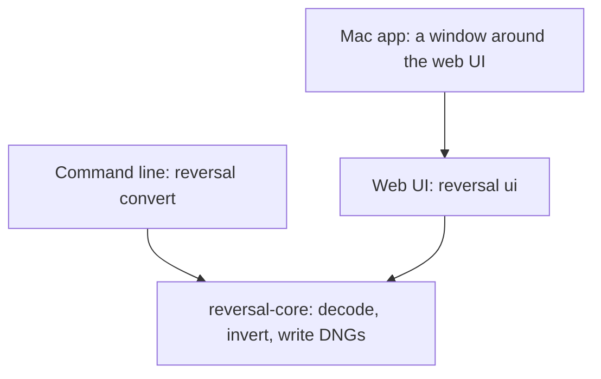

# Reversal: Product Spec

Reversal turns a camera scan of a film negative into a positive raw file that edits like a normal photo. This doc is the source of truth for what the product is and why. Evidence and rejected options for the conversion and file format are in the [Supporting Research](research.md).

## Product

Reversal bakes the inversion into the pixels but keeps them linear, high-bit and raw-editable, so every raw tool treats the file as an ordinary positive photo. Sliders go the right way, and nothing extra needs to be installed to see it correctly.

It is for photographers who scan negatives with a camera and edit in a raw editor.

| Product rule | What it means |
| --- | --- |
| A positive raw file | The result is a DNG, not a look stacked on a negative or a rendered TIFF or JPEG |
| Film science, not stacked curves | Inversion works in density, with the film base removed exactly |
| Automatic first | An untouched frame gets a full conversion; every control starts at 0 |
| Non-destructive | Source scans are never overwritten |

It ships as three surfaces over one engine: a self-hosted CLI, a local web UI and a Mac app. It converts color and black and white negatives. Editor plugins, extensions and slide film are out of scope.

## Input

Reversal reads camera raw and DNG files directly through LibRaw and works in the camera's native RGB. It has no separate raw-to-DNG step.

A negative scan is not a scene: it is three dye layers measured through a backlight, so the camera acts as a crude densitometer. That is why the camera's color profile is never applied to the negative.

| Parameter | Decision |
| --- | --- |
| Formats | NEF, NRW, CR2, CR3, ARW, RAF, RW2, ORF, PEF, SRW, DNG |
| Decoding | Linear camera RGB, 16-bit, AHD demosaic, gamma 1 |
| Applied by the decoder | Nothing that renders color: no camera matrix, no auto brightness, unit channel multipliers, highlights clipped |
| Levels | The same scale for every frame of a roll, so frames stay comparable |
| Unsupported camera | The user converts to DNG first with Adobe DNG Converter |

## Output file

The output is a 16-bit, scene-linear LinearRaw DNG in linear Rec.2020, with lossless compression and no embedded original. A 16 MP scan comes to about 62–64 MB.

| Element | Value | Why |
| --- | --- | --- |
| Photometric interpretation | LinearRaw, 3 samples per pixel | Already demosaiced, so raw tools skip their demosaic |
| Sample format | 16-bit integer | Widest reader support |
| Pixel values | Scene-linear positive | Exposure, white balance and curves behave as on a digital photo |
| Color space | Linear Rec.2020, described by the file's color matrices | Takes the camera out of the equation |
| Camera model | "Reversal Positive", with embedded profiles | No external profile needed |
| Highlight headroom | Frame white stored about 2.3 stops under full scale, with every profile curve lifting it back and rolling off the rest | Raw tools can recover highlights above frame white |
| White balance | AsShotNeutral 1, 1, 1; `crs:WhiteBalance="As Shot"` | The white balance slider starts neutral |
| Profiles | Reversal Neutral, Flat and Hard, or their B&W versions; the chosen one is the main profile | Editors can switch, and Apple Photos applies only the main profile |
| Black point | DefaultBlackRender set to None | Renderers subtract no black level of their own, so the curve decides |
| Compression | Lossless JPEG, tiled at 256 px; uncompressed as an option | Read everywhere |
| Geometry | Applied to the pixels; orientation tag stays normal | Nothing depends on a reader honoring crops or rotation |
| Crop | Entire scan unless the user crops | Keeps rebate and holder by default |
| Previews | 256 px thumbnail, 1024 px sRGB JPEG | Fast browsing |
| Metadata | Source file name and all settings in XMP | The conversion can be repeated |

### Exposure and profiles

BaselineExposure is 0 for every look, and no profile has an exposure offset. Each curve maps the whole stored range to the display and carries the highlight roll-off itself, because renderers treat data above display white differently. Curves have 1024 evenly spaced samples and run from (0, 0) to (1, 1), because Apple's engine misreads or replaces anything else. Tone sliders change only the profile curves, so the stored image keeps everything.

### File locations

| Item | Web UI and Mac app | CLI |
| --- | --- | --- |
| DNG | `positives/<name>-positive.dng` in the scans folder | `<name>-positive.dng` next to the input, or `-o` |
| A frame's current settings | `positives/<file>.reversal.json` | None |
| Settings used for the saved DNG | `positives/<file>.reversal.in-dng.json` | None |
| Frames a running save hasn't reached | `positives/.reversal-saving.json`, removed when the save ends | None |

The CLI refuses to overwrite a source file or to write two inputs to one output.

### Compatibility

The DNG opens correctly in Lightroom Classic, Lightroom mobile, Camera Raw and Apple Photos. Camera Raw is the reference for how a file should look, and Apple Photos now opens close to it, with a slight shift left.

Raising Exposure or curves in Apple Photos clips bright highlights sooner than in Camera Raw, and turns saturated colors near white to white, because Photos applies its edits through a tone curve rebuilt from three samples of the profile's. Camera raws show it too, but the headroom our curves roll off makes it start sooner. For frames with bright highlights, set exposure in Reversal, or edit in Camera Raw or Lightroom.

## Conversion science

Conversion happens in density and writes a scene-linear positive. Film records log exposure as optical density, and density is additive: the orange mask is a constant per-channel offset, so it subtracts exactly. In plain RGB the same operation is a multiplication, which is why curve-based inversion fights color balance. Black and white follows the same principle with one silver image in place of three dye layers.

### Pipeline

1. **Decode.** Raw file to linear camera RGB.
2. **Measure.** Film base and measured area set what the steps below use; see Automatic measurement.
3. **Density above base.** Per channel, density is the negative log of the signal relative to the film base. This removes the orange mask, and also makes input white balance irrelevant.
4. **Gray curves.** Per frame, red and blue map onto green density with a one-bend curve through the base, so neutrals stay neutral at every density.
5. **Crosstalk.** A fixed correction on the red–green and blue–green density differences. Neutrals pass unchanged. It was fitted to a D5100 and one light source.
6. **Toe.** A small toe shared by all channels, expanded near the base.
7. **Back to linear.** Exposure anchor and film gamma turn density into scene-linear RGB, with the exposure and color sliders as per-channel offsets in stops.
8. **Saturation.** Linear, around Rec.2020 luminance, 1.25 by default.
9. **Geometry and writing.** Straighten and crop come before inversion, mirror and quarter turns after. Measuring reads the straightened scan too, so the areas match what's shown. Then the DNG is written.

Steps 3 to 7 per channel c:

```latex
L_c = 10^{\,(E'_c - A)/\gamma \,+\, o_c \log_{10} 2}, \qquad E'_c = \mathrm{toe}(\mathrm{crosstalk}(g_c(D_c))), \qquad D_c = -\log_{10}(T_c / T_{\mathrm{base},c})
```

Here T is the signal, T\_base the film base, g\_c the frame's gray curve (identity for green), A the exposure anchor, γ = 0.7 and o\_c the sliders in stops.

### Black and white

Silver blocks every color about equally, so a black and white negative needs no gray curves, crosstalk or saturation. Density above base still comes per channel, which takes out the base's tint, fog and the scan's white balance. The three densities then become one, each weighted by the light it gets through the base, since a brighter channel is less noisy:

```latex
E = \sum_c w_c D_c, \qquad w_c = \frac{T_{\mathrm{base},c}}{\sum_k T_{\mathrm{base},k}}
```

Toe, exposure anchor and γ are the same as for color, so Exposure behaves the same. The positive is that one value in all three channels of linear Rec.2020, and only Exposure acts on the pixels.

### Automatic measurement

| Value | How it's measured | Override |
| --- | --- | --- |
| Film type | Measured on cells of 4 by 4 analysis pixels in the measured area, as density above base, so white balance can't sway it. Black and white when 90% of cells lie within 0.02 density of the frame's own gray curve, and red density rises with green at a slope within 0.05 of 1. Color film fails the first wherever the scene has color, and the second even on a gray scene, because its dye layers rise at different rates. A frame spanning too little density to tell is color, the conversion that loses nothing. Detection sets the type when a frame is first measured; measuring again for a new area, base or angle keeps it | Color or B&W |
| Film base | The largest even patch of the brightest film, trying the film's edges first, then a strip across the scan such as the gap between frames. Holes, markings and picture detail break a patch's evenness, and the holder is darker. Saying detection failed is preferred to marking an unwanted area: when no patch looks like clear film, the app warns, keeps a best guess for the conversion, and asks for a custom film base or a roll base | Custom, or shared across a roll |
| Measured area | The centered 85% of each side, leaving out the film holder: cells far denser than film (green density above 1.2) connected to the scan's edge, plus a small margin for the holder's soft edge. Dense cells that reach the middle of the scan are picture, and nothing is left out on that frame, so a custom area is the fix when dense picture joins the holder. This only affects measuring, not how the holder renders | Size from 50 to 100%, or drawn by hand. A drawn area is measured exactly as drawn, holder included |
| Gray curves | Fitted to the frame's own near-neutral pixels, with no reference. The band narrows from ±0.15 to ±0.04 density, bins count equally, and the fit is pulled lightly toward an average across rolls | None; there are no RGB or CMY controls |
| Exposure anchor | The mean of the 99th percentile and the average of equivalent green density | The Exposure slider |

Measurement runs on the scan downsampled by 4. Pixels of light through holes and gaps are left out.

### What lives where

Exposure and color balance go into the pixels. Tone shaping goes into the profile curve, so it stays adjustable in a raw editor and never costs stored data.

A settings file records a model version. When the model changes, older settings keep the user's choices and are measured again, with a warning.

## Controls and workflow

The screen separates what can break a conversion from what develops it: frames on the left, the image in the middle, and on the right the histogram, then Setup, then development controls. In a wide window, frame tools and Save sit in a top bar, which names the open frame; the name opens and closes the frames list, and the folder's name heads the list. There's no status bar, so the image keeps the full height and portrait layouts keep the bottom edge free. Save progress fills the Save button, which reads Stop · 3 of 12 while saving. Everything that floats over the image shares one look. An open tool's bar, for Crop, Show areas or drawing a film base or measured area, sits at the top center and never covers the image: the image eases smaller into the room below it, the bar then fades in, and on Cancel or Done the bar fades out before the image eases back. Messages sit at the foot of the image, one at a time, and pass over it without resizing it. A message fades in; one that follows while it shows, such as a measurement's result after Measuring…, changes its words at once and the box takes their height, then eases to their width. Growing, it uncovers the words through a soft right edge that clears as it arrives, so they never rewrap. A message without buttons is its words alone, centered. A message fades after three and a half seconds, longer for longer words up to eight, a save's result with Show in Finder included; one that needs reading, such as a problem, stays until the next message or another frame opens. A click or tap anywhere on a message but its buttons and Details dismisses it; a double-click selects a word instead, and keyboards and screen readers get a Dismiss button. Bars and messages are see-through: they dim the image under them by about a quarter, without blur, and their text carries a shadow so it reads on bright pictures. While cropping, the image also keeps clear of the frame's handles, so they stay in reach. A message longer than a line opens from Details, which also keeps it. Escape closes a tool first, and only then a message. Every choice in these bars is a labeled button, so they read the same and are easy to hit on a touch screen. The frames list shows the open frame's place in the roll, or how many are selected, and the version at its foot opens About. Controls are plain sliders from −100 to +100, with 0 as the automatic result and a value you can type. Clicking or tapping a slider's label edits its value. In the side panel, a slider's label and value share a line and the track spans the panel's full width below them, for precision; choices keep their label on the left and their buttons on the right. Straighten in the wide top bar takes the bar's free width, up to 440 px; in the crop bar and the phone's Crop panel it takes their full width. Double-clicking a slider resets it. Up and down arrows move between frames, except while the crop frame is open, and ⌘S or Ctrl+S saves. The look is neutral gray in the system font, with one blue for checkboxes, focus and Save. Icons share one drawing: a 1.25 px rounded stroke on a 16 px grid. Motion is brief and only shows what changed. A panel that changes height slides there, and the image resizes with it; switching panels changes what they show at once, and only the edge moves. The frames column slides in from the left and out again. The floating histogram opens by growing from its corner in one motion that uncovers a part at a time: the histogram, then the clipping numbers, then the range warning when there is one. It folds the same way back, and its icon fades in once the box has folded. When the clipping numbers or the range warning come and go as a slider moves, the box grows before their words fade in, and their words fade out before it shrinks. Bars, messages, dialogs and the floating histogram fade in, and bars, messages and the histogram fade out as they step aside. With reduced motion set on the system, everything changes at once.

On a touch screen, including a laptop's, every control answers to at least 44 px, the size fingers need, and rows are 44 px apart. Sliders get a larger thumb, and typed values use 16 px text so that iOS doesn't zoom in. With a mouse, the layout keeps its 24 px density: at 44 px, the Develop panel would scroll on a 900 px high screen and the frame list would show half as many frames. Both densities are one layout with two sets of sizes.

The layout follows the window, and in each one the frames list and the tools take turns rather than both crowding the image:

- **Wide landscape:** the three columns above. The frames column hides from the open frame's name, giving the image its width, and stays as it was left. The side panel scrolls as one under the histogram, which stays in place behind a seam.
- **Narrower landscape, and portrait from 600 px wide:** rotate and mirror stay in the top bar, and crop and straighten wait behind a crop button there. It opens them in a bar of their own under the top bar, with their names, which moves the image down rather than covering it, so the crop frame's handles stay in reach.
- **Portrait from 600 px wide:** the image takes the full width, and under it the tools sit in two columns, or the frames list in their place. Turning the device to portrait with a frame open shows the tools; turning back brings the frames column back as it was.
- **A phone held upright:** the image, then one panel, chosen from a bar at the bottom: Crop, Setup, Tone or Color, each an icon over its name. Setup is a wrench, Tone a disc half dark and half lit, for contrast and brightness, and Color a thermometer. A black and white frame has no Color, so Tone takes its place. Crop holds rotate, mirror, the crop choices and Straighten. The frame's name opens the frames list in the panel's place. A panel takes only the height it needs, up to about four rows, and scrolls past that, so the image keeps most of the screen and barely changes size between panels.
- **Histogram, in portrait and on a phone:** it floats over the image's top right corner and shows the clipping numbers only when something clips. Tapping it folds it to an icon, which brings it back and turns amber while the DNG can't store every pixel. It steps aside while a tool works on the image. Where it's too narrow for the names, the clipping numbers show alone, under the ends of the histogram they count.

### Writing

UI text uses simple, declarative language, explains briefly, and uses established UI terms where they exist. A message says what happened and what to do. One term means one thing everywhere: a frame is one file in the list, and a scan is its whole image. Custom means set by the user, measure covers everything Reversal reads from a scan, and film terms the audience knows stay, such as film base and clear film. Clipped means clipped in the preview, which the DNG keeps; beyond DNG range means brighter than the DNG can store, and gone for good. Messages over the image and warnings in a panel end without a period; dialogs and tooltips keep full punctuation.

### Setup

Setup decides how the scan is read. It stays pinned above the development controls and never scrolls away, so a suspect base is visible while you judge color. A frame with no clear film shows a warning there.

| Control | Choices |
| --- | --- |
| Film | Color or B&W, showing what the frame converts as. Choosing the type it doesn't read as marks Film with a dot, and choosing the detected one again goes back to detecting; the tooltip says which. B&W leaves only Tone under Develop |
| Film base | Detect, or Custom to drag over clear film by hand. Match film base… shares one across frames |
| Measured | Center (size 50–100%, default 85%, without the holder), or Custom to drag over the picture by hand, which is the fix when the holder is misjudged. Sets where color and exposure are measured, never the crop |
| Show areas | Draws the film base, measured area and crop on the entire scan, and its message names each one with a dot in its color; the dots pace the list, so it has no commas. With Center, the detected holder is hatched in red and named in the message too, as auto-ignored in measurement. A custom area leaves nothing out, so neither the hatching nor the name shows |

Each group shows one choice: the one in use, or Custom while its drag tool is open. The Center size slider hides with a custom area. Choosing another option cancels an unfinished drag, and Cancel or Escape does too. A dot in the frame list marks a chosen film type, or a custom film base or measured area.

The dots after a label show only once its choice departs from what's detected: Film after choosing the type the scan doesn't read as, Film base for a custom or roll base, Measured for a custom area or Center size, and Crop for any crop where its label shows (on a phone, the Crop panel's choices say it instead). A screen reader reads the dot as changed. Each takes its area's color: orange for the film base, light blue for the measured area, purple for the crop, and light gray for the film type, which draws no area. Red, yellow and green are kept for status, so the holder, which the analysis leaves out, is the only area in red.

### Development

| Control | Range | Where it acts |
| --- | --- | --- |
| Exposure | ±3 stops | Pixels |
| Contrast | ×/÷ 2.6 curve slope at the ends | Profile curve |
| Highlights, Shadows | ±100 | Profile curve |
| Whites | −100 rolls off the whole stored range, +100 clips sooner | Profile curve |
| Blacks | −100 crushes the black point, +100 lifts it, except at the very bottom of the stored range, where the curve has to start at 0 | Profile curve |
| Profile | Neutral, Flat, Hard | Which profile the file opens with |
| Temperature | Red and blue in opposite directions, ±0.6 EV. Color film only, like Tint and Saturation | Pixels |
| Tint | Green against red and blue | Pixels |
| Saturation | −100 is black and white | Pixels |
| Rotate 90°, Mirror | Quarter turns, left-right flip; both act on the image as shown | Pixels |
| Straighten | ±10°. A new angle closes Show areas and any open drag tool, but not the crop frame. Film base and colors are measured again on letting go of the slider, or after a short pause for arrow keys and typed values, never while it's held. Saving or changing frame waits for that measurement. Custom areas keep their place on the scan, so a large turn can move them off their target | Pixels and measuring |
| Crop | Entire scan, Measured area, or Custom. Sets what the DNG keeps, never the colors | Pixels |

Custom crop shows the entire scan and dims what's outside a frame. The frame opens on the custom crop if there is one, otherwise on the crop in use, which starts as the entire scan. Choosing Entire scan or Measured area keeps the custom crop with the frame's settings, so Custom brings it back. It stays out of the DNG and doesn't count as an edit. Film base and measured area stay single drags because they pick a sample; a crop is a composition, so it stays adjustable until it's accepted.

| Action | Result |
| --- | --- |
| Drag a corner or edge | Resizes the frame. Shift on a corner keeps its shape. The frame stops at the scan and at a minimum size |
| Drag inside | Moves the frame. A frame filling the scan can't move, so this draws a new one |
| Drag outside | Draws a new frame |
| Arrows | Move the frame, or the focused edge or corner, by one screen pixel. Shift moves by 10. Tab reaches the edges and corners |
| Done or Enter | Applies the frame |
| Cancel or Escape | Keeps the crop as it was |
| Entire scan or Measured area | Closes the frame and uses that choice |
| Saving, changing frame, opening another area tool, or Match film base | Applies the frame first, so what's saved matches what's shown and adjustments aren't lost |

Straighten, Rotate and Mirror keep the frame open, and it holds its place on the scan. Its corner and edge markers sit outside the frame, so they never cover a pixel the DNG keeps.

Reset, in the Develop header, returns the tone and color controls to 0 and the profile to Neutral. It leaves geometry, crop and Setup alone. On a black and white frame it leaves the hidden color controls too, so they're back as they were if the frame turns to color.

### Profiles

| Profile | Rendering |
| --- | --- |
| Reversal Neutral | The standard S-curve, with a short roll-off above frame white |
| Reversal Flat | Low contrast, with the whole stored range rolled off below white |
| Reversal Hard | More contrast, plus 1.15 saturation in a look table. It was called Vivid, and settings that say so still open |

All three share the tone sliders. The DNG carries all three. A black and white frame gets Reversal B&W Neutral, Flat and Hard instead: the same curves, with a look table holding saturation at 0. White balance or saturation moves in an editor then can't tint the picture, and toning applied after the profile, such as color grading, still works.

### Feedback

The preview uses a quarter-size scan and the chosen profile's curve in ProPhoto, approximating how a raw editor opens the file. The histogram shows display clipping, and a separate warning appears only when pixels exceed what the DNG can store, measured on the picture. In the side panel it fades in over the top of the histogram, across its width, so the panel doesn't move under a slider being dragged; where the histogram floats, it sits under the clipping numbers. Display clipping is recoverable; stored clipping isn't.

### Frames and saving

- **Settings:** each frame remembers its settings from the first change.
- **State:** the list shows `saved` or `edited`. A frame counts as edited when its settings or film type differ from its DNG's, or from the automatic ones if it has no DNG, so going back clears the label.
- **Saving:** select frames to save them together in the background, each with its own settings. Untouched frames get the automatic conversion, and Stop saving lets the frames in progress finish and starts no more. A save that's cut short, because the app was closed or the device needed a rest, leaves its unsaved frames listed in the folder. The page offers them once, when the folder is next open or when the save stops: Saving stopped with 7 frames left, with Save them. Stopping a save with its button offers nothing: that was the user's choice. The result names the DNG by its path from the open folder, such as `positives/<name>-positive.dng`: the folder is named on screen, and its full path is long and says nothing inside an app's own storage.
- **Roll:** Match film base… shares one film base across selected frames or the whole folder, in three steps. It says what will happen, measures each frame without changing anything, then shows every result so the user selects which frames to use. The base is the median of the selected results. Frames with no clear film start deselected, and results over 6% from the roll's in any channel are flagged. It can be stopped, and no frame changes unless every frame could be prepared. It is opt-in because a shared base can add a color cast on some rolls. Gray curves stay per frame, a custom film base on a frame stays, and Detect goes back to the frame's own.

### CLI

`reversal convert` exposes the same adjustments as flags and takes `--roll` for several inputs, leaving out frames with no clear film unless none has any. `reversal ui` opens the web UI on a folder. The README lists every flag.

## Architecture

One engine library, `reversal-core`, holds all conversion logic. Every surface is a thin adapter over it, so a conversion comes out the same from any of them.



The Mac app shows the same web page as the browser, so there is one UI to maintain. It adds only what a page can't do: start the engine, choose a folder and show a file in Finder.

An iOS app for iPhone and iPad is a prototype and isn't released. It shows the same page, with the engine linked into the app, because iOS can't start another process. The page loads from the app's own scheme, `reversal://app`, and each of its requests is a call into the engine. There's no server and no port, so nothing outside the app can reach the engine, and nothing stops answering while the app is in the background. Its Swift side adds only what a page can't do there: reach files outside the app, and hand DNGs to Photos, Files and other apps. The page asks its shell what it does differently, and adapts itself: where the shell hands saved DNGs to other apps, the button after a save reads Export… in place of Show in Finder. No shell changes the page from outside. Where a shell hands DNGs to other apps, the frames list has Export… at its foot, for the DNGs of the selected frames or of the open one. The button after a save covers only what that save wrote, and fades with its message, so without this a DNG saved earlier couldn't leave the app. A save goes on while the app is off screen: from iOS 26 as a task the system shows with its progress, and before that for the half minute iOS allows. When that time runs out, or the device reaches its hottest state, the save stops for now and the rest is offered again. On a memory warning the app lets go of the frames it keeps ready to show. An iPhone stays upright. On its side one panel of tools fits beside the image, but the image keeps about a third of the screen, too little to judge a conversion while moving a slider. An iPad turns freely.

| Part | Responsibility |
| --- | --- |
| `crates/reversal-core` | Decode, invert, render previews, write DNGs; no UI, servers or host SDKs |
| `crates/reversal-cli` | The `reversal` binary: `convert`, plus the `ui` server, batches and per-frame settings |
| `crates/reversal-cli/ui` | The web page, embedded in the binary |
| `packaging/macos` | The Swift window, icon and disk image build |
| `crates/reversal-ios` | The engine as a static library with a C interface, for the iOS app |
| `packaging/ios` | The iOS app prototype: Xcode project, Swift shell and engine build script |

### Rules

- **Deterministic:** the same input and parameters give a bit-identical output.
- **Non-destructive:** files are written through a temporary file, sources are never replaced, and an existing file is only replaced if it is a positive Reversal wrote.
- **Local only:** the server binds to loopback and refuses other hosts, other origins, non-JSON posts and what another site loads without a preflight. The page runs under a content security policy that allows only its own files. The Mac app chooses a free port and its engine exits with the app.
- **Parallel:** pixel work uses all cores. Decoding runs one frame at a time, because LibRaw isn't used in its thread-safe form.
- **Precision:** processing runs in 32-bit float and quantizes only on export.

## Tech stack

| Need | Choice | Note |
| --- | --- | --- |
| Language | Rust, stable, Cargo workspace | Memory-safe parsing of untrusted files |
| Raw decoding | LibRaw over its C API, under the CDDL 1.0 in every build | System library in development; in the Mac app, 0.22.3 built in statically, without OpenMP, lcms or libjpeg |
| DNG writing | Our own minimal writer, including lossless JPEG | No Adobe SDK in the product |
| JPEG previews | `jpeg-encoder` | Always without chroma subsampling |
| Web server | `tiny_http` | One small dependency, no framework |
| Settings and arguments | `serde`, `serde_json`, `clap` |  |
| Web UI | Plain HTML, CSS and JS | No frontend build step |
| Mac app | Swift, Cocoa and WKWebView | arm64, macOS 13 or later, ad hoc signed; building it needs Xcode |
| License | Mozilla Public License 2.0 | Open source, can be sold in app stores, and improvements to existing files stay open; the photo in the README screenshot isn't covered |
| Tests | `cargo test`, on small synthetic images | CI runs them on Linux and macOS; golden reference images aren't built yet |

## Known limits

- **Film:** slide film is out of scope. Film type detection was tested on two cameras and one light source each; black and white was checked by eye, with no reference scans. Chromogenic black and white film is untested.
- **Cameras:** tested only with Nikon D5100 scans. Others LibRaw reads should open, but the crosstalk correction was fitted to this camera and one light source.
- **Full strips:** the centered area doesn't suit them, so set a custom measured area and crop there.
- **Film base:** detection reports no clear film on scans with little or no visible edge, and can miss an uneven one. Set a custom film base, or match it across the roll.
- **Metadata:** camera EXIF isn't copied to the DNG.
- **Mac app:** Apple Silicon only, and it can't read DNGs with lossy JPEG compression. It is ad hoc signed, so users approve it with Open Anyway.

[GitHub issues](https://github.com/janwiktor/reversal/issues) track which of these may change.
