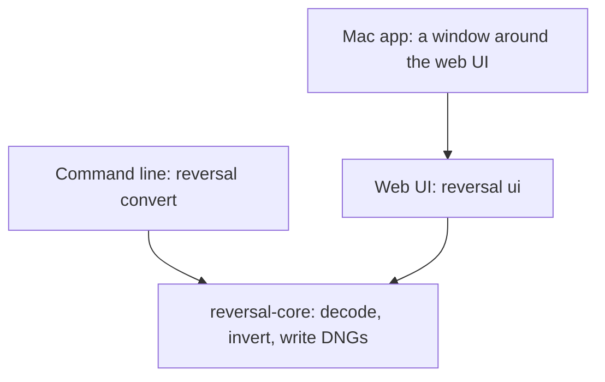

# Reversal: Product Spec

Reversal turns a camera scan of a film negative into a positive raw file that edits like a normal photo. This doc is the source of truth for what the product is and why. Evidence and rejected options are in the [Supporting Research](research.md).

## Product

Reversal bakes the inversion into the pixels but keeps them linear, high-bit and raw-editable, so every raw tool treats the file as an ordinary positive photo. Sliders go the right way, and nothing extra needs to be installed to see it correctly.

It is for photographers who scan negatives with a camera and edit in a raw editor.

| Product rule | What it means |
| --- | --- |
| A positive raw file | The result is a DNG, not a look stacked on a negative or a rendered TIFF or JPEG |
| Film science, not stacked curves | Inversion works in density, with the film base removed exactly |
| Automatic first | An untouched frame gets a full conversion; every control starts at 0 |
| Non-destructive | Source scans are never overwritten |

It ships as three surfaces over one engine: a self-hosted CLI, a local web UI and a Mac app. Editor plugins and extensions are out of scope. Color negative is the only film type today.

## Input

Reversal reads camera raw and DNG files directly through LibRaw and works in the camera's native RGB. It has no separate raw-to-DNG step.

A negative scan is not a scene: it is three dye layers measured through a backlight, so the camera acts as a crude densitometer. That is why the camera's color profile is never applied to the negative.

| Parameter | Decision |
| --- | --- |
| Formats | NEF, NRW, CR2, CR3, ARW, RAF, RW2, ORF, PEF, SRW, DNG |
| Decoding | Linear camera RGB, 16-bit, AHD demosaic, gamma 1 |
| Applied by the decoder | Nothing that renders color: no camera matrix, no auto brightness, unit channel multipliers, highlights clipped |
| Levels | The same scale for every frame of a roll, so frames stay comparable |
| Unsupported camera | The user converts to DNG first with Adobe DNG Converter |

## Output file

The output is a 16-bit, scene-linear LinearRaw DNG in linear Rec.2020, with lossless compression and no embedded original. A 16 MP scan comes to about 62–64 MB.

| Element | Value | Why |
| --- | --- | --- |
| Photometric interpretation | LinearRaw, 3 samples per pixel | Already demosaiced, so raw tools skip their demosaic |
| Sample format | 16-bit integer | Widest reader support |
| Pixel values | Scene-linear positive | Exposure, white balance and curves behave as on a digital photo |
| Color space | Linear Rec.2020, described by the file's color matrices | Takes the camera out of the equation |
| Camera model | "Reversal Positive", with embedded profiles | No external profile needed |
| Highlight headroom | Frame white stored about 2.3 stops under full scale, with BaselineExposure lifting it back | Raw tools can recover highlights above frame white |
| White balance | AsShotNeutral 1, 1, 1; `crs:WhiteBalance="As Shot"` | The white balance slider starts neutral |
| Profiles | Reversal Neutral, Flat and Vivid; the chosen one is the main profile | Editors can switch, and Apple Photos applies only the main profile |
| Compression | Lossless JPEG, tiled at 256 px; uncompressed as an option | Read everywhere |
| Geometry | Applied to the pixels; orientation tag stays normal | Nothing depends on a reader honoring crops or rotation |
| Crop | Whole scan unless the user crops | Keeps rebate and holder by default |
| Previews | 256 px thumbnail, 1024 px sRGB JPEG | Fast browsing |
| Metadata | Source file name and all settings in XMP | The conversion can be repeated |

### Exposure and profiles

BaselineExposure follows the main profile instead of using a profile exposure offset on it, because Apple's renderer opens files too bright when the main profile carries one. Other profiles carry the difference as an offset. Tone sliders change only the profile curves, so the stored image keeps everything.

### File locations

| Item | Web UI and Mac app | CLI |
| --- | --- | --- |
| DNG | `positives/<name>-positive.dng` in the scans folder | `<name>-positive.dng` next to the input, or `-o` |
| A frame's current settings | `positives/<file>.reversal.json` | None |
| Settings used for the saved DNG | `positives/<file>.reversal.in-dng.json` | None |

The CLI refuses to overwrite a source file or to write two inputs to one output.

### Compatibility

The DNG opens correctly in Lightroom Classic, Lightroom mobile, Camera Raw and Apple Photos. Camera Raw is the reference for how a file should look. Apple Photos has its own rendering, with a slight shift.

## Conversion science

Conversion happens in density and writes a scene-linear positive. Film records log exposure as optical density, and density is additive: the orange mask is a constant per-channel offset, so it subtracts exactly. In plain RGB the same operation is a multiplication, which is why curve-based inversion fights color balance.

### Pipeline

1. **Decode.** Raw file to linear camera RGB.
2. **Measure.** Film base and measured area set what the steps below use; see Automatic measurement.
3. **Density above base.** Per channel, density is the negative log of the signal relative to the film base. This removes the orange mask, and also makes input white balance irrelevant.
4. **Gray curves.** Per frame, red and blue map onto green density with a one-bend curve through the base, so neutrals stay neutral at every density.
5. **Crosstalk.** A fixed correction on the red–green and blue–green density differences. Neutrals pass unchanged. It was fitted to a D5100 and one light source.
6. **Toe.** A small toe shared by all channels, expanded near the base.
7. **Back to linear.** Exposure anchor and film gamma turn density into scene-linear RGB, with the exposure and color sliders as per-channel offsets in stops.
8. **Saturation.** Linear, around Rec.2020 luminance, 1.25 by default.
9. **Geometry and writing.** Straighten and crop come before inversion, mirror and quarter turns after. Then the DNG is written.

Steps 3 to 7 per channel c:

```latex
L_c = 10^{\,(E'_c - A)/\gamma \,+\, o_c \log_{10} 2}, \qquad E'_c = \mathrm{toe}(\mathrm{crosstalk}(g_c(D_c))), \qquad D_c = -\log_{10}(T_c / T_{\mathrm{base},c})
```

Here T is the signal, T\_base the film base, g\_c the frame's gray curve (identity for green), A the exposure anchor, γ = 0.7 and o\_c the sliders in stops.

### Automatic measurement

| Value | How it's measured | Override |
| --- | --- | --- |
| Film base | The largest even patch of the brightest film, trying the film's edges first, then a strip across the scan such as the gap between frames. Holes, markings and picture detail break a patch's evenness, and the holder is darker. Saying detection failed is preferred to marking an unwanted area: when no patch looks like clear film, the app warns, keeps a best guess for the conversion, and asks for a pick or a roll base | Picked by hand, or shared across a roll |
| Measured area | The centered 85% of each side, clear of holders and rebates on a framed scan | Size from 50 to 100%, or drawn by hand |
| Gray curves | Fitted to the frame's own near-neutral pixels, with no reference. The band narrows from ±0.15 to ±0.04 density, bins count equally, and the fit is pulled lightly toward an average across rolls | None; there are no RGB or CMY controls |
| Exposure anchor | The mean of the 99th percentile and the average of equivalent green density | The Exposure slider |

Measurement runs on the scan downsampled by 4. Pixels of light through holes and gaps are left out.

### What lives where

Exposure and color balance go into the pixels. Tone shaping goes into the profile curve, so it stays adjustable in a raw editor and never costs stored data.

A settings file records a model version. When the model changes, older settings keep the user's choices and are measured again, with a warning.

## Controls and workflow

The screen separates what can break a conversion from what develops it: frames on the left, the image in the middle, and on the right the histogram, then Setup, then development controls. Frame tools and Save sit in a top bar; messages and save progress sit in a status bar. Controls are plain sliders from −100 to +100, with 0 as the automatic result and a value you can type. Double-clicking a slider resets it. Up and down arrows move between frames, and ⌘S or Ctrl+S saves. The look is neutral gray in the system font, with one blue for ticks, focus and Save.

### Setup

Setup decides how the scan is read. It stays pinned above the development controls and never scrolls away, so a suspect base is visible while you judge color. A frame with no clear film shows a warning there.

| Control | Choices |
| --- | --- |
| Film base | Detect or Pick by hand. Match film base… shares one across frames |
| Measured | Center (size 50–100%, default 85%), or Draw area by hand. Sets where color and exposure are measured, never the crop |
| Show areas | Draws the crop, measured area and film base on the whole scan |

A dot in the frame list marks a film base or area set by hand.

### Development

| Control | Range | Where it acts |
| --- | --- | --- |
| Exposure | ±3 stops | Pixels |
| Contrast | ×/÷ 2.6 curve slope at the ends | Profile curve |
| Highlights, Shadows | ±100 | Profile curve |
| Whites | −100 rolls off the whole stored range, +100 clips sooner | Profile curve |
| Blacks | ±100 | Profile curve |
| Profile | Neutral, Flat, Vivid | Which profile the file opens with |
| Temperature | Red and blue in opposite directions, ±0.6 EV | Pixels |
| Tint | Green against red and blue | Pixels |
| Saturation | −100 is black and white | Pixels |
| Rotate 90°, Mirror | Quarter turns, left-right flip; both act on the image as shown | Pixels |
| Straighten | ±10° | Pixels |
| Crop | Whole scan, Measured area, or Draw crop. Sets what the DNG keeps, never the colors | Pixels |

Reset, in the Develop header, returns the tone and color controls to 0 and the profile to Neutral. It leaves geometry, crop and Setup alone.

### Profiles

| Profile | Rendering |
| --- | --- |
| Reversal Neutral | The standard S-curve, with highlights clipping as on a print |
| Reversal Flat | Low contrast, with the whole stored range rolled off below white |
| Reversal Vivid | More contrast, plus 1.15 saturation in a look table |

All three share the tone sliders. The DNG carries all three.

### Feedback

The preview uses a quarter-size scan and the chosen profile's curve in ProPhoto, approximating how a raw editor opens the file. The histogram shows display clipping, and a separate warning in the status bar appears only when pixels exceed what the DNG can store, measured on the picture. Display clipping is recoverable; stored clipping isn't.

### Frames and saving

- **Settings:** each frame remembers its settings from the first change.
- **State:** the list shows `saved` or `edited`. A frame counts as edited when its settings differ from its DNG's, or from the automatic ones if it has no DNG, so going back clears the label.
- **Saving:** tick frames to save them together in the background, each with its own settings. Untouched frames get the automatic conversion, and Stop saving lets the frames in progress finish and starts no more.
- **Roll:** Match film base… shares one film base across ticked frames or the whole folder, in three steps. It says what will happen, reads each frame without changing anything, then shows every reading so the user chooses which count. The base is the median of the ticked readings. Frames with no clear film start unticked, and readings over 6% from the roll's in any channel are flagged. It can be stopped, and no frame changes unless every frame could be prepared. It is opt-in because it hurts some rolls. Gray curves stay per frame, a base picked by hand on a frame stays, and Detect goes back to the frame's own.

### CLI

`reversal convert` exposes the same adjustments as flags and takes `--roll` for several inputs, leaving out frames with no clear film unless none has any. `reversal ui` opens the web UI on a folder. The README lists every flag.

## Architecture

One engine library, `reversal-core`, holds all conversion logic. Every surface is a thin adapter over it, so a conversion comes out the same from any of them.



The Mac app shows the same web page as the browser, so there is one UI to maintain. It adds only what a page can't do: start the engine, choose a folder and show a file in Finder.

| Part | Responsibility |
| --- | --- |
| `crates/reversal-core` | Decode, invert, render previews, write DNGs; no UI, servers or host SDKs |
| `crates/reversal-cli` | The `reversal` binary: `convert`, plus the `ui` server, batches and per-frame settings |
| `crates/reversal-cli/ui` | The web page, embedded in the binary |
| `packaging/macos` | The Swift window, icon and disk image build |

### Rules

- **Deterministic:** the same input and parameters give a bit-identical output.
- **Non-destructive:** files are written through a temporary file, and sources are never replaced.
- **Local only:** the server binds to loopback and refuses other hosts, other origins and non-JSON posts. The Mac app chooses a free port and its engine exits with the app.
- **Parallel:** pixel work uses all cores. Decoding runs one frame at a time, because LibRaw isn't used in its thread-safe form.
- **Precision:** processing runs in 32-bit float and quantizes only on export.

## Tech stack

| Need | Choice | Note |
| --- | --- | --- |
| Language | Rust, stable, Cargo workspace | Memory-safe parsing of untrusted files |
| Raw decoding | LibRaw over its C API | System library in development; in the Mac app, 0.22.3 built in statically under the LGPL 2.1, without OpenMP, lcms or libjpeg |
| DNG writing | Our own minimal writer, including lossless JPEG | No Adobe SDK in the product |
| JPEG previews | `jpeg-encoder` | Always without chroma subsampling |
| Web server | `tiny_http` | One small dependency, no framework |
| Settings and arguments | `serde`, `serde_json`, `clap` |  |
| Web UI | Plain HTML, CSS and JS | No frontend build step |
| Mac app | Swift, Cocoa and WKWebView | arm64, macOS 13 or later, ad hoc signed; building it needs Xcode |
| License | GNU GPL, version 3 or later | Forks and improvements stay open; the photo in the README screenshot isn't covered |
| Tests | `cargo test`, on small synthetic images | CI runs them on Linux and macOS; golden reference images aren't built yet |

## Known limits

- **Film:** color negative only; black and white and slide film need their own pipelines.
- **Cameras:** tested only with Nikon D5100 scans. Others LibRaw reads should open, but the crosstalk correction was fitted to this camera and one light source.
- **Full strips:** the centered area doesn't suit them, so draw the area and crop there.
- **Film base:** detection reports no clear film on scans with little or no visible edge, and can miss an uneven one. Pick the base, or match it across the roll.
- **Metadata:** camera EXIF isn't copied to the DNG.
- **Mac app:** Apple Silicon only, and it can't read DNGs with lossy JPEG compression. It is ad hoc signed, so users approve it with Open Anyway.

[GitHub issues](https://github.com/janwiktor/reversal/issues) track which of these may change.
